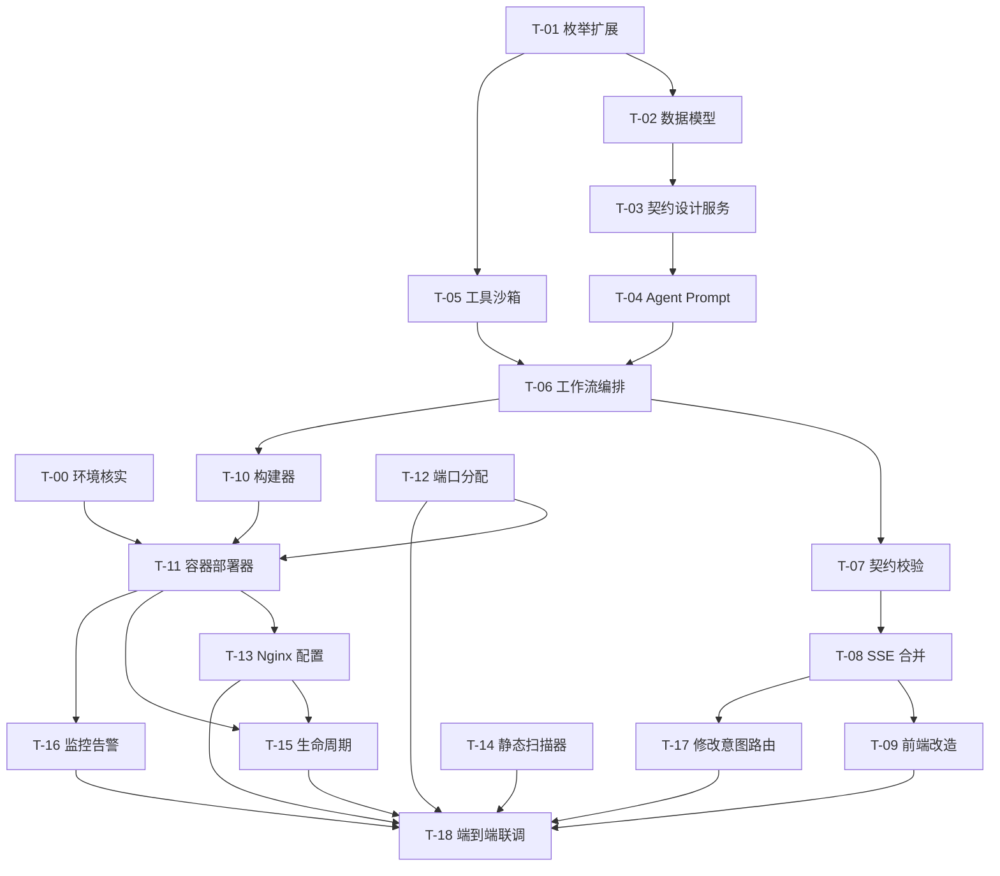

# 全栈项目生成模块 · 任务文档

> [!NOTE]
> 这份 v1.0 文档从 2026-09-13 起记录全栈生成模块的排期、实现进度和联调结果。
> 参见 [全栈设计记录](全栈项目生成模块设计与实现.md) 和当前的 [项目启动说明](../README.md#快速开始)。

---

## 1. 任务总览

### 1.1 里程碑

| 里程碑 | 范围 | 交付标准 |
|---|---|---|
| **M1 可演示** | T-00 ~ T-13 | 勾选生成 → 双 Agent 出前后端 → 契约校验 → 部署到 `/apps/{deployKey}/` 可访问（页面 + API + 数据库） |
| **M2 可上线** | + T-14 ~ T-17 + 安全基线全过 | 具备安全防护（扫描/监控）、容器生命周期管理、修改对话路由 |
| **M3 增强** | 见 1.4 待办池 | 配额可视化、日志查看、契约人工审核等 |

### 1.2 任务汇总表

| 编号 | 任务 | 阶段 | 前置 | 预估 | 里程碑 | 状态 |
|---|---|---|---|---|---|---|
| T-00 | 服务器环境核实 | 前置 | — | 0.5h | M1 | ✅ 已完成（2026-09-13） |
| T-01 | 枚举扩展（类型 + Agent 角色） | 一 基础 | — | 1h | M1 | ✅ 已完成（2026-09-13） |
| T-02 | 请求与数据模型变更 | 一 基础 | T-01 | 1h | M1 | ✅ 已完成（2026-09-13） |
| T-03 | 架构师 Agent：契约设计服务 | 二 生成核心 | T-02 | 3h | M1 | ✅ 已完成（2026-09-13） |
| T-04 | Agent Prompt（前端微调 + 后端新增） | 二 生成核心 | T-03 | 4h | M1 | ✅ 已完成（2026-09-13） |
| T-05 | 工具沙箱改造（角色目录隔离） | 二 生成核心 | T-01 | 3h | M1 | ✅ 已完成（2026-09-13） |
| T-06 | 工作流编排（双 Agent 并行） | 二 生成核心 | T-04, T-05 | 4h | M1 | ✅ 已完成（2026-09-13） |
| T-07 | 契约校验节点（提取 + 回环） | 二 生成核心 | T-06 | 4h | M1 | ✅ 已完成（2026-09-13） |
| T-08 | SSE 合并输出（agentRole 标识） | 二 生成核心 | T-07 | 3h | M1 | ✅ 已完成（2026-09-13） |
| T-09 | 前端改造（勾选 + 双流展示 + 弹窗修正） | 四 前端 | T-08 | 3h | M1 | ✅ 已完成（2026-09-13） |
| T-10 | 全栈项目构建器 | 三 构建部署 | T-06 | 3h | M1 | ✅ 已完成（2026-09-13） |
| T-11 | 容器部署器（compose + 健康检查） | 三 构建部署 | T-00, T-10 | 6h | M1 | ✅ 完成（本机 Docker 端到端通过，2026-09-14） |
| T-12 | 端口分配器 | 三 构建部署 | T-02 | 2h | M1 | ✅ 已完成（2026-09-13） |
| T-13 | 动态 Nginx 配置 + reload（双机） | 三 构建部署 | T-11 | 4h | M1 | ✅ 完成（双机配置 + 本机/服务器链路均验证，2026-09-14） |
| T-14 | 代码静态扫描器 | 五 安全治理 | —（可并行） | 3h | M2 | ✅ 完成（单测 + 真实产物零误报，2026-09-14） |
| T-15 | 容器生命周期接口（停用/重启/删除） | 五 安全治理 | T-11, T-13 | 3h | M2 | ✅ 完成（本机 compose 停用留卷/重启数据在实测，2026-09-14） |
| T-16 | 容器监控与告警 | 五 安全治理 | T-11 | 4h | M2 | ✅ 完成（阈值告警/自动重启/冷却/状态落库实测，2026-09-14） |
| T-17 | 修改对话意图路由 | 五 安全治理 | T-08 | 3h | M2 | ✅ 完成（分类冒烟 + 修改工作流端到端，沙箱仅动目标目录，2026-09-14） |
| T-18 | 端到端联调验收 | 六 联调 | 全部 | 8h | M2 | ✅ 完成（用例 1~7 通过、基线 9/10 并留 1 项风险 M3；修复阻断级缺陷 1 个，2026-09-14） |

**总预估：约 62.5h（≈ 8 人日）**；M1 约 41.5h，M2 追加约 21h。

### 1.3 依赖关系图



**并行建议：**
- T-14（扫描器）无依赖，任何时候可插入
- T-09（前端）可在 T-08 冻结消息结构后提前用 mock 数据开发
- T-12 已先于 T-11 完成（T-11 的端口依赖）；T-13 / T-16 在 T-11 完成后可并行

**M2 完成状态（2026-09-14）**：T-14 ~ T-18 全部完成。全量单测 **96 个用例全绿**（BUILD SUCCESS）。T-18 端到端用例 1~7 通过、基线 9/10，并修复 1 个阻断级缺陷（风险 13）与 1 个测试不可重跑缺陷。**安全基线 10 项中 9 项通过**，第 6 项「容器网络隔离」经实测判定设计文档原方案（`internal: true`）不可用，按决策记录为已知风险（风险 14）转入 M3 —— 即里程碑表中「安全基线全过」这一条**未字面达成**，属经确认的风险接受，非遗漏。

### 1.4 M3 待办池（不排期）

- **容器网络隔离加固**（T-18 基线第 6 项遗留；`internal: true` 已验证不可用，需换方向：宿主防火墙限制容器网段出向 / rootless 或用户命名空间）
- 资源配额可视化（CPU/内存/磁盘用量看板）
- 应用日志查看（容器 stdout 聚合到管理端）
- 一键停止（基于 T-15 接口做 UI）
- 契约人工审核（管理端查看/编辑 `api-contract.json`）
- 共享 MySQL 实例模式（缓解设计文档风险 #9：每应用容器内存压力）

---

## 2. 前置任务

### T-00 服务器环境核实（0.5h）

**目标**：确认部署目标环境具备容器化条件，避免 T-11/T-13 返工（对应设计文档风险 #8）。

**核查项（内网机 + 公网入口机都要查）：**

- [ ] `docker version` ≥ 20.10
- [ ] `docker compose version`（v2 子命令可用）
- [ ] `baiye` 用户免 sudo 执行 `docker ps`（已在 docker 组）
- [ ] 基础镜像可拉取/已预拉：`node:18-alpine`、`mysql:8.0`（对应风险 #3）
- [ ] 磁盘剩余 ≥ 20G（`df -h`）
- [ ] 端口段 3100-3200 空闲（`ss -tlnp`）
- [ ] `/project/tmp` 可写；现有 `/dist` 静态部署不受影响（回归保护）
- [ ] 公网入口机可访问内网机反代端口（参照 `/dist` 双机经验）

**验收**：全部勾选；如有缺口记录到风险表并制定对策。

> 注：本任务已于 2026-09-13 标记完成（见汇总表），但上述 8 项核查清单未逐条回填勾选状态。T-18 期间仅复验了与本机链路相关的部分（Docker 可用、镜像可构建），**其余服务器侧项目（磁盘水位、端口段、免 sudo、公网入口连通性）未在 T-18 复核**，如需追溯请补齐记录。

---

## 3. 阶段一：基础数据与配置

### T-01 枚举扩展（1h）

**目标**：新增全栈生成类型与 Agent 角色枚举。

**交付物：**
- 修改 `src/main/java/com/wkr/aicode/model/enums/CodeGenTypeEnum.java`
  - 新增 `FULLSTACK_VUE_NODEJS("Vue+Node.js 全栈模式", "fullstack_vue_nodejs")`
- 新建 `src/main/java/com/wkr/aicode/model/enums/AgentRoleEnum.java`
  - 值：`ARCHITECT / FRONTEND / BACKEND`

**实现要点：**
- 参照现有枚举风格（构造器 + `getEnumByValue`）
- 目录前缀约定：`fullstack_project_{appId}`

**验收：**
- [x] `getEnumByValue("fullstack_vue_nodejs")` 返回正确枚举（`CodeGenTypeEnum:12`）
- [x] 全量编译通过；现有类型 switch 的 default 分支不受影响

---

### T-02 请求与数据模型变更（1h）

**目标**：勾选参数落库 + 部署信息存储。

**交付物：**
- 修改 `model/dto/app/AppAddRequest.java`：新增 `Boolean generateBackend`
- 修改 `model/entity/App.java`：新增 `generateBackend`、`nodePort`、`containerName`、`containerStatus`
- 修改 `sql/init.sql`：app 表新增 4 个字段（新环境建库用）—— **已完成**
- 新增 `sql/upgrade_fullstack.sql`：存量环境升级脚本（开发库/生产库 ALTER）—— **已完成**
  ```sql
  ALTER TABLE app
      ADD COLUMN generateBackend tinyint  default 0 not null comment '是否同步生成 Node.js 后端（0-否 1-是）' AFTER deployedTime,
      ADD COLUMN nodePort        int                 null comment '全栈应用部署宿主端口' AFTER generateBackend,
      ADD COLUMN containerName   varchar(64)         null comment '全栈应用 Docker 容器名' AFTER nodePort,
      ADD COLUMN containerStatus varchar(16)         null comment '容器状态：running/stopped/failed' AFTER containerName;
  ```

**实现要点：**
- 修改 `AppServiceImpl.createApp()`：
  ```java
  CodeGenTypeEnum selectedCodeGenType = Boolean.TRUE.equals(appAddRequest.getGenerateBackend())
          ? CodeGenTypeEnum.FULLSTACK_VUE_NODEJS
          : routingService.routeCodeGenType(initPrompt);
  ```
- 实体字段与 MyBatis-Flex 映射一致（列名与 init.sql 保持一致：camelCase）
- 部署前对开发库/生产库执行 `sql/upgrade_fullstack.sql`

**验收：**
- [x] `sql/init.sql` app 表包含 4 个新字段
- [x] `sql/upgrade_fullstack.sql` 可在存量库执行成功
- [x] 勾选创建 → `codeGenType = fullstack_vue_nodejs` 落库（T-18 用例 1）
- [x] 不勾选 → 行为与现状一致（回归）（T-18 用例 7）
- [x] 新字段读写正常（T-18 用例 1/2/6：`generateBackend`/`nodePort`/`containerName`/`containerStatus` 均已实测读写）

---

## 4. 阶段二：多智能体生成核心

### T-03 架构师 Agent：契约设计服务（3h）

**目标**：工作流首节点，产出前后端共用的 API 契约。

**交付物：**
- 新建 `src/main/resources/prompt/api-contract-design-system-prompt.txt`
- 新建 `src/main/java/com/wkr/aicode/ai/ApiContractDesignService.java`（LangChain4j 接口）
- 新建 `src/main/java/com/wkr/aicode/ai/model/ApiContract.java`（`models[]` / `apis[]` / `responseFormat`，结构见设计文档附录 A）

**实现要点：**
- Prompt 输出**纯 JSON**（禁止 markdown 包裹），配合 JSON schema 校验
- 解析失败自动重试 ≥ 1 次，仍失败抛 `BusinessException`（对应风险 #10）
- 结果存 `WorkflowContext.apiContract` + 写盘 `api-contract.json`

**验收：**
- [x] 固定样例需求 → 输出符合 schema 的 JSON
- [x] 非法输出触发重试（日志可见）后失败路径正常
- [x] `api-contract.json` 写入产物根目录

**完成说明（2026-09-13）：** 新增 `ApiContractDesignService`（LangChain4j 接口）+ `ApiContractDesignServiceFactory`（单例 Bean）+ `ApiContractDesignFacade`（解析 / 结构校验 / 重试 / 落盘）+ `prompt/api-contract-design-system-prompt.txt`；`WorkflowContext` 增加 `apiContract` 字段。单元测试 `ApiContractDesignFacadeTest` 8/8 通过（覆盖合法解析、markdown 包裹容错、校验失败回传问题重试、模型调用失败重试、连续失败抛 `BusinessException`、落盘）。真实模型链路待 T-18 端到端验证。

---

### T-04 Agent Prompt（4h）

**目标**：两份专家 Prompt 就绪。

**交付物：**
- 新建 `src/main/resources/prompt/codegen-nodejs-backend-system-prompt.txt`
- ~~微调 `codegen-vue-project-system-prompt.txt`~~ → 改为新建 `codegen-fullstack-frontend-system-prompt.txt`（实施偏离，见完成说明）

**实现要点（后端 Prompt 必须覆盖）：**
- 安全约束段（设计文档 7.2 第 3 层原文）
- 技术栈固定：Express 4.x + Sequelize + mysql2 + dotenv
- 部署形态：托管 `public/` + SPA 路由兜底 + `/api` 挂载
- 根目录部署文件：Dockerfile / docker-compose.yml / .env.example / README.md（模板注入 vs AI 生成，实施时二选一，默认**模板注入**更稳）
- 输出约束沿用现有风格（必须用文件写入工具、token < 20000、文件数受限、不输出安装指导）

**验收：**
- [x] 人工评审两份 Prompt 覆盖全部要点；安全约束段与设计文档一致

**完成说明（2026-09-13）：**
- 后端 Prompt：覆盖安全约束段（7.2 第 3 层原文，并补充一句澄清——禁止的是「输出/返回环境变量」，按约定读取 `DB_*` 属允许行为，避免与「必须遵守 2」自相矛盾）、技术栈固定、运行环境约定（0.0.0.0:3000、`DB_*` 环境变量、`GET /api/health`、统一响应格式、启动建表+种子数据重试）、接口实现约定、数据模型约定、参考代码（app.js / database.js / init.js / package.json）、输出约束；明确要求不生成 Dockerfile / docker-compose.yml / .env.example / README.md（按 T-04 默认采用**模板注入**）。
- 前端 Prompt：**未改动现有 `codegen-vue-project-system-prompt.txt`**，而是新建 `codegen-fullstack-frontend-system-prompt.txt`。原因：该文件同时被独立的 Vue 工程模式（`VUE_PROJECT`）复用，若就地加入「路径以 `frontend/` 开头」会让独立模式产物写进错误的子目录；新建文件可避免回归，且与本项目「一种模式一份 Prompt」的既有约定一致。
- 前端 Prompt 额外补充两条硬约束（不在原任务描述中，但对子路径部署是必需的）：① 所有接口调用必须走相对路径 `./api/xxx`（绝对路径 `/api/xxx` 在 `/apps/{deployKey}/` 下会打到主站）；② 统一用 `utils/request.js` 封装 fetch，不引入 axios，便于 T-07 契约校验器稳定提取调用清单。

---

### T-05 工具沙箱改造（3h）

**目标**：Agent 角色目录隔离，防并行写冲突与越权（对应风险 #11）。

**交付物：**
- ~~新建 `ai/context/AgentContextHolder.java`（ThreadLocal）~~ → 改为新建 `ai/tool/AgentWorkspace.java` + `ai/tool/ToolSetFactory.java`（实施偏离，见完成说明）
- 修改 `BaseTool` + `FileWriteTool` / `FileModifyTool` / `FileDeleteTool` / `FileReadTool` / `FileDirReadTool`
- 目录策略（与设计一致）：
  | 角色 | 可写范围 |
  |---|---|
  | ARCHITECT | 根目录白名单（api-contract.json） |
  | FRONTEND | 强制 `frontend/` 前缀 |
  | BACKEND | 强制 `backend/` 前缀 + 根文件白名单（Dockerfile、docker-compose.yml、.env.example、README.md） |
  | 无角色（旧模式） | 产物根目录内均可写 |

**实现要点：**
- 现有 `FileWriteTool` 的 `projectDirName` 硬编码 `vue_project_` → 统一改由 `AgentWorkspace` 解析；**未绑定工作区时回退到 `vue_project_{appId}`**（兼容回归）
- 路径穿越防护：`normalize()` 后必须仍在项目根内（防 `../`）；角色前缀校验基于 **normalize 之后的相对路径**，防止 `frontend/../backend/x.js` 绕过
- 越权写入返回错误字符串给 AI（同 `hallucinatedToolNameStrategy` 兜底风格）

**验收：**
- [x] 单元测试：FRONTEND 写 `../backend/x.js` 被拒；BACKEND 写 `frontend/a.vue` 被拒；ARCHITECT 写白名单外被拒；合法路径成功
- [x] 原有 VUE_PROJECT 生成回归通过（T-18 用例 7；期间发现并修复 T-18 记录的 message 列容量缺陷）

**完成说明（2026-09-13）：**
- **决策变更（经用户确认）**：放弃 ThreadLocal 方案，改为 **per-agent 工具实例**。原因：工具虽无状态可并发，但 LangChain4j 的工具执行线程与工作流节点线程不保证是同一个，ThreadLocal 会丢上下文（项目中 `ReactorThreadLocalConfig` 的存在即为佐证）。改为每个 Agent 构建时由 `ToolSetFactory` 创建独立工具实例，`AgentWorkspace`（产物根目录 + 角色）绑定为实例字段。
- **统一解析入口**：`BaseTool` 新增 `workspace` 字段 + `resolveWorkspace(appId)`；5 个文件工具全部改走 `resolveForWrite` / `resolveForRead`，删除了各自硬编码的 `vue_project_` 逻辑。
- **读 vs 写**：写/改/删受角色目录限制；读只限制「不得逃出产物根目录」，允许读取另一侧 Agent 的产物（便于 AI 排错），与任务表中「可写范围」的表述一致。
- **顺带加固**：旧的绝对路径分支（`if (!path.isAbsolute())`）会让 AI 直接写到任意绝对路径，现已一律拒绝绝对路径并返回错误字符串。旧模式下 `../` 可逃出产物根目录，现同样被拒。
- 单测 `AgentWorkspaceTest` 13/13 通过（角色隔离、穿越绕过、绝对路径、跨 Agent 读、旧模式回退、工具实例端到端写入）。

---

### T-06 工作流编排（4h）

**目标**：`FullstackCodeGenWorkflow` 串起架构师 + 双 Agent 并行。

**交付物：**
- 新建 `langGrapgh4J/FullstackCodeGenWorkflow.java`
- 新建节点：`ArchitectNode`、`FrontendAgentNode`、`BackendAgentNode`（参照 `CodeGeneratorNode` 写法）
- 扩展 `WorkflowContext`：`apiContract`、`frontendDir`、`backendDir`

**实现要点：**
- 图：`START → architect →（并行）frontend / backend →（校验节点预留）`
  - 开发期可先直连 build，T-07 完成后插入校验节点
- 节点内同步等待（`blockLast`，参照 `CodeGeneratorNode`）
- 并行执行参照 `CodeGenConcurrentWorkflow` 模式
- ~~节点内设置 `AgentContextHolder`（与 T-05 联动）~~ → T-05 改为 per-agent 工具实例方案，工作区在 `AiCodeGeneratorServiceFactory` 构建 Agent 服务时绑定，节点内无需设置上下文

**验收：**
- [x] MERMAID 图输出与设计一致（`START → architect → frontend_agent / backend_agent → END`）
- [x] 日志显示前端/后端节点执行时间重叠（并行）（T-18 用例 1；另见 T-09 冒烟：前端 15.5s / 后端 17.6s 同时启动、输出交错）
- [x] 产物目录 `frontend/` + `backend/` 均生成（T-18 用例 1）

**完成说明（2026-09-13）：**
- **交付物清单**：
  - `langGrapgh4J/FullstackCodeGenWorkflow.java`：`createWorkflow(AgentStreamPipe)` + `executeWorkflowWithFlux(prompt, appId)`（`Flux.create` + `Thread.startVirtualThread`，`RunnableConfig.addParallelNodeExecutor("architect", pool)`，finally 中 `pool.shutdown()`）
  - `langGrapgh4J/node/fullstack/` 三节点：`ArchitectNode`、`FrontendAgentNode`、`BackendAgentNode`，另抽了 `AgentStreamPipe`
  - `AppConstant.FULLSTACK_PROJECT_DIR_PREFIX = "fullstack_project_"` + `fullstackProjectDir(appId)`
  - `WorkflowContext` 新增 `apiContract` / `fullstackProjectDir` / `frontendDir` / `backendDir`
  - `AiCodeGeneratorService` 新增 `generateFullstackFrontendCodeStream` / `generateNodeBackendCodeStream`
  - `AiCodeGeneratorServiceFactory.getFullstackAgentService(appId, role)`（缓存键 `{appId}_{fullstack_vue_nodejs}_{role}`，每角色独立 `MessageWindowChatMemory`，`tools(toolSetFactory.createFullstackTools(projectDir, role).toArray())`）
  - `AiCodeGeneratorFacade.generateFullstackAgentCodeStream(appId, role, userMessage)`（只负责生成与流式推送，不含构建，构建归 T-10）
- **产物目录在串行前置节点确定**：`fullstackProjectDir/frontendDir/backendDir` 与 `apiContract` 全部由 `architect` 节点写入，两个并行 Agent 节点**不修改**上下文（只 log + emit AI 回复），规避 LangGraph4j 并行分支状态合并的覆盖风险。
- **SSE 安全**：`FluxSink` 非线程安全，双 Agent 并行 `sink.next` 必须串行 → `AgentStreamPipe.emit` 用 `synchronized (sink)`；`emitAiResponse` 复用 `AiResponseMessage` JSON 结构（agentRole 字段留 T-08）。
- **并行执行方式**：`completion` 走节点内 `blockLast(Duration.ofMinutes(10))` 同步等待（与 `CodeGeneratorNode` 一致），并行度由 `addParallelNodeExecutor("architect", pool)` 提供（与 `CodeGenConcurrentWorkflow` 的 `image_plan` 同一模式）；池用 `ExecutorBuilder` 4/8 + `Fullstack-Agent-` 线程名前缀。
- **并行分支未接构建节点**：按任务表「开发期可先直连 build，T-07 完成后插入校验节点」，当前 `frontend_agent/backend_agent → END`，T-07 将把两个分支汇聚到 `contract_check` 再条件边到 build。
- **全栈前端 Prompt 独立文件**（承 T-04 偏离）：`codegen-fullstack-frontend-system-prompt.txt`，未改动被独立 VUE_PROJECT 模式复用的 `codegen-vue-project-system-prompt.txt`。
- `JAVA_HOME=ms-21.0.7 mvn -DskipTests compile` 通过（EXIT=0）。

---

### T-07 契约校验节点（4h）

**目标**：代码级提取 + 差异比对 + 修复回环。

**交付物：**
- 新建 `langGrapgh4J/node/ContractCheckNode.java`
- 新建 `utils/RouteExtractor.java`（后端路由提取：扫描 `backend/src` 的 `router.*` / `app.use`）
- 新建 `utils/ApiCallExtractor.java`（前端调用提取：axios / fetch 的 `/api/*` 路径）
- 条件边：`通过 → build`；`不通过 → 对应 Agent`（差异注入 prompt）

**实现要点：**
- 三方比对：`api-contract.json` vs 后端路由 vs 前端调用
- 结果写 `QualityResult`（errors = 差异清单，复用现有模型）
- **回环上限 2 次**防死循环，超限终止并向用户报明确错误

**验收：**
- [x] 人为构造"前端调用无后端路由" → 判失败且差异描述正确（`ContractCheckNodeTest`：缺失 `GET /api/posts/:id`、`POST /api/posts` 与前端越界 `/api/tags` 均准确识别）
- [x] 修复后重跑判通过（`ContractCheckNodeTest.passesWhenBothSidesMatchContract`）
- [x] 回环上限生效（`FullstackCodeGenWorkflowTest`：第 1/2 轮退回 Agent，第 3 轮 give_up，共 2 轮修复）

**完成说明（2026-09-13）：**
- **交付物清单**：
  - `langGrapgh4J/node/fullstack/ContractCheckNode.java`（按 T-06 目录约定放入 `node/fullstack/`，非任务表的 `node/`）
  - `langGrapgh4J/utils/RouteExtractor.java`（后端路由提取）
  - `langGrapgh4J/utils/ApiCallExtractor.java`（前端调用提取）
  - `langGrapgh4J/utils/ApiPathUtil.java`（新增共享归一化工具，三方比对都依赖，故从两个提取器中抽出）
  - `WorkflowContext` 新增 `contractCheckResult`、`contractCheckRound`、`frontendFixHints`、`backendFixHints`
  - 工作流：`frontend_agent / backend_agent → contract_check`，条件边 `pass→END（T-10 接 build）| frontend/backend→退回修复 | give_up→END`
- **并行语义已实测确认**（新增 `FullstackGraphSemanticsTest` 探针，2 个用例）：LangGraph4j 1.6.0-rc2 下（1）汇聚节点会等待双分支都结束后**只执行一次**；（2）回环后仅单分支重跑时，汇聚节点**能再次触发**（不会因等待另一分支而死锁）。因此「双 Agent → 校验 → 退回单 Agent」拓扑成立。
- **路由提取**：沿 `require` + `use` 挂载链还原完整路径（`app.use('/api', routes)` + `router.use('/posts', postRoutes)` + `router.get('/:id')` → `GET /api/posts/*`）；挂载链有环保护；`node_modules` 跳过；`app.get('*')`（SPA 兜底）与 `req.get('Header')` 不会误判为接口。**内联 `require` 挂载**（`app.use('/api', require('./routes'))`）也在「已被引入」判定内，否则被挂载文件会被当成入口导致前缀丢失（该 bug 由单测发现并修复）。
- **前端调用提取**：既抓 `./api/xxx`、`/api/xxx`、`/api/xxx/${id}` 字面量，也抓请求封装 `request('/posts')` / `http.get('/posts')` 短路径（按契约约定基地址 `./api` 补全前缀）；模板字面量、查询串、`BASE_URL` 常量、vite 代理、前端路由配置均不误判。
- **归一化规则**（`ApiPathUtil`）：去查询串/哈希、去 `./`/`../` 前缀、合并重复斜杠、去末尾斜杠、`:id`/`{id}`/`${...}` 统一为 `*`，使 `./api/posts/`、`/api/posts/:id`、`/api/posts/${id}` 可三方比对。
- **比对语义**：契约是唯一事实来源 —— 后端必须实现契约全部接口（方法 + 路径，缺一即报「后端缺少接口」），前端只能调用契约内路径（否则报「前端调用了契约外接口」）；后端契约外接口只进 `suggestions` 提示、不阻断。
- **修复回环**：`ContractCheckNode.MAX_FIX_ROUNDS = 2`，即校验最多执行 3 次（首检 + 2 次复检）；`round > 2` 时节点输出「已达修复上限…终止生成」并由条件边 `give_up → END`。问题清单写入 `frontendFixHints / backendFixHints`，由对应 Agent 在下一轮消息中追加「上一轮契约校验未通过，请修复以下问题」并要求用**文件修改工具定向修复**（不重新生成整个项目）。契约缺失接口影响更大，因此后端问题优先修复。
- 测试：`RouteExtractorTest`、`ApiCallExtractorTest`、`ContractCheckNodeTest`、`FullstackCodeGenWorkflowTest`、`FullstackGraphSemanticsTest` 共 11 个用例全部通过。
- **遗留**：`pass` 分支当前直连 END，T-10 构建器完成后改为接入构建节点（已于 T-10 完成：`pass → build → END`）。

---

### T-08 SSE 合并输出（3h）

**目标**：双 Agent 流合并推送，消息带角色标识。

**交付物：**
- 修改 `ai/message/AiResponseMessage`、`ToolExecutedMessage`：加 `agentRole` 字段
- 工作流/Facade 聚合：`Flux.merge()`（参照 `executeWorkflowWithFlux`）
- `AppController.chatToGenCode` 对 `FULLSTACK_VUE_NODEJS` 走工作流分支

**实现要点：**
- 复用现有 SSE 框架与结束标记（`event: done` 保持）
- 新增字段对旧前端向后兼容（多余字段被忽略）

**验收：**
- [x] 生成过程 SSE 消息全部带 `agentRole`（`AgentStreamPipeTest`：并行推送的 40 条消息各自带正确角色；架构师/前端/后端节点的进度消息按角色标注）
- [x] 并行阶段两个 Agent 的消息均可达（`AgentStreamPipeTest.parallelAgentsMessagesAllCarryOwnRole`：双虚拟线程各推 20 条，一条不丢）
- [x] 结束后 `done` 事件正常（工作流 `sink.complete()` → `AppController.chatToGenCode` 的 `concatWith(done 事件)` 逻辑未改动）

**完成说明（2026-09-13）：**
- **交付物清单**：
  - `ai/message/StreamMessage.java`：基类新增 `agentRole` 字段（三个子类共用，避免重复字段）
  - `ai/message/AiResponseMessage`、`ToolRequestMessage`、`ToolExecutedMessage`：各新增带角色的构造重载
  - `langGrapgh4J/node/fullstack/AgentStreamPipe.java`：新增 `forRole(role)` 生成角色管道视图，与原始管道共享同一 sink（`synchronized (sink)` 串行写不变）；不带角色的管道用于系统级消息
  - `core/AiCodeGeneratorFacade.java`：`processAgentTokenStream(tokenStream, agentRole)` 在**消息构造处**直接写角色（不做 JSON 二次解析）；`generateAndSaveCodeStream` 新增 `FULLSTACK_VUE_NODEJS` 分支 → `executeWorkflowWithFlux`
  - `langGrapgh4J/FullstackCodeGenWorkflow.java`：三个节点分别接入 `pipe.forRole(ARCHITECT/FRONTEND/BACKEND)`
- **聚合方式**：任务表写的是 `Flux.merge()`，实际采用**共享 sink 聚合**（T-06 已定型）：并行节点把消息写入同一个 `AgentStreamPipe`，等价于在汇聚点合并，且天然保证 sink 串行写入。若改用 `Flux.merge()`，并行 `sink.next` 的线程安全问题反而需要额外处理。
- **消息结构**（与设计文档 4.3 一致，取值用小写枚举 value）：
  ```json
  { "type": "ai_response",  "agentRole": "frontend", "data": "..." }
  { "type": "tool_executed", "agentRole": "backend",  "id": "...", "name": "...", "arguments": "...", "result": "..." }
  ```
- **向后兼容**：Hutool 默认忽略 null 字段，非全栈模式的消息**不含** `agentRole` 键（`AgentStreamPipeTest.messagesWithoutRoleKeepLegacyPayload` 断言）；`JsonMessageStreamHandler` 用 `JSONUtil.toBean` 解析，多出的字段被忽略，对话历史聚合文本不变。
- **API 契约分支**：`FULLSTACK_VUE_NODEJS` 走工作流后，`StreamHandlerExecutor` 已将该类型路由到 `JsonMessageStreamHandler`（T-02 已接），对话历史的用户消息与 AI 回复持久化链路无需改动。
- **顺带修复**：工作流在虚拟线程中执行，`ThreadLocal` 不继承导致 `MonitorContextHolder` 上下文丢失（模型监控记录会缺 appId/userId）。现于 `Flux.create` 订阅线程捕获快照，在虚拟线程设置、`finally` 清理。
- 测试：新增 `AgentStreamPipeTest`（3 用例），与 T-07 的 11 用例合计 14 个全部通过。
- **遗留**：端到端 SSE 实测（真实模型驱动、`done` 事件到达前端）留待 T-09 前端改造后联调 —— 已于 2026-09-13 完成真实模型验证，结果与顺带修复的两个端到端断点见 T-09 完成说明。

---

## 5. 阶段三：构建与部署

### T-10 全栈项目构建器（3h）

**目标**：构建前端、复制产物、构建镜像。

**交付物：**
- 新建 `core/builder/FullstackProjectBuilder.java`
  - `buildFrontend(projectDir)`：`npm install && npm run build`（复用 VueProjectBuilder 命令执行逻辑）
  - `copyDistToPublic(projectDir)`：`frontend/dist/* → backend/public/`
  - `buildImage(projectDir, deployKey)`：`docker build -t fullstack-{deployKey}:latest`

**实现要点：**
- 服务器 npm 符号链接已就绪（见部署经验）；命令执行环境参照 `VueProjectBuilder`

**验收：**
- [x] 构建后 `backend/public/index.html` 存在（真实模型冒烟测试断言：生成 → 契约校验通过 → build 节点 → `backend/public/index.html` 就绪）
- [x] `docker images` 可见镜像（T-18 用例 2：本机 Docker Desktop 实测 `fullstack_pqet89-app` 镜像构建成功；镜像 tag 设计偏差见下方完成说明）

**完成说明（2026-09-13）：**
- **交付物清单**：
  - `core/builder/FullstackProjectBuilder.java`：`buildFrontend`（复用 `VueProjectBuilder.buildProject` 的 npm 命令执行逻辑）/ `copyDistToPublic`（先清空旧产物再复制，校验 `index.html` 落地）/ `buildImage`（`docker build -t {tag}:latest .`，600s 超时）/ `isDockerAvailable`（探测 Docker 可用性，本机无 Docker 时跳过）
  - `langGrapgh4J/node/fullstack/BuildNode.java`：构建节点，逐步把进度（构建前端 / 复制产物 / 预构建镜像）推送到 SSE
  - `FullstackCodeGenWorkflow`：新增 `build` 节点，`contract_check` 的 `pass` 分支由直连 END 改为进 `build`，`build → END`
- **设计偏差（镜像 tag）**：任务表/设计文档写 `fullstack-{deployKey}`，但生成阶段尚无 deployKey（`deployApp` 时才生成），故生成阶段以 `fullstack-{appId}` 预构建；其意义在于复用 layer 缓存、提前暴露构建问题，部署阶段由 compose 按 deployKey 重新构建。
- **失败策略**：镜像预构建失败或 Docker 不可用**不阻断生成**（流中输出明确提示，部署时 compose 仍会构建）；前端构建失败不抛异常，写入 `WorkflowContext.errorMessage` 并在流中提示用户（可继续对话让 AI 修复）。
- **测试**：`FullstackProjectBuilderTest` 4 用例（复制并清理过期文件、dist 缺失、frontend/package.json 缺失、Dockerfile 缺失）；冒烟测试新增 `backend/public/index.html` 断言，覆盖"生成 → 校验 → 构建"完整链路。

---

### T-11 容器部署器（6h）

**目标**：compose 生成 + 启动 + 健康检查 + 回滚。

**交付物：**
- 新建 `service/ContainerDeployService.java`
- 新建运行时模板 `src/main/resources/deploy/`（Dockerfile / docker-compose.yml 占位符版本，设计文档 6.2）
- 修改 `AppServiceImpl.deployApp()`：`FULLSTACK_VUE_NODEJS` 走容器部署分支

**实现要点：**
- 生成 `.env`：随机 16 位 `DB_PASSWORD` / `MYSQL_ROOT_PASSWORD`、分配端口
- 命令：`docker compose -p fullstack_{deployKey} up -d --build`
- 健康检查：轮询 `http://127.0.0.1:{port}/api/health` 至 200（超时 60s）
- **失败回滚**：健康检查失败 → `docker compose down` + 明确错误信息
- 幂等：重复部署 = 更新代码 → build → `up -d`
- 更新 app 表：`deploy_key` / `node_port` / `container_name` / `container_status` / `deployed_time`

**验收：**
- [x] 部署后 `docker ps` 显示 app + mysql 两容器 running（T-18 用例 2/6 实测）
- [x] 健康检查通过；页面与 API 均可达（T-18 用例 2：`/apps/PqEt89/` 页面 + `/api/health` + 数据库种子数据全链路）
- [x] 重复部署不产生重复容器（T-18 用例 2/3/4：三次重部署均为同名容器重建，mysql 容器与数据卷保留）
- [x] 失败场景回滚执行且用户收到明确错误（T-18 用例 5：安全扫描拒绝后容器零变更；用例 6：删除后资源全清）

**完成说明（2026-09-13，代码与单测完成；端到端已于 2026-09-14 验证，见下「端到端验证记录」）：**
- 交付：`ContainerDeployService.java` + `resources/deploy/Dockerfile.template` + `resources/deploy/docker-compose.yml.template` + `AppServiceImpl.deployApp()` 全栈分支
- 与设计的偏差（主动修正）：
  - `Dockerfile` 用 `npm install --omit=dev` 而非 `npm ci`（AI 生成的后端没有 package-lock.json）
  - compose 模板去掉已废弃的 `version:` 键；工程名/容器名小写化（docker 工程名要求）
  - `.env` 幂等保留（已存在则不动）：MySQL 数据卷中的密码只在首次初始化生效，重新生成随机密码会导致连接失败
  - 安全基线已内置：`cap_drop: ALL`、`no-new-privileges`、`read_only` + `tmpfs /tmp`、资源 limits（app 0.5C/512M/pids100，mysql 0.3C/256M）
- T-13 联调时已接入：健康检查通过后写反代配置（`NginxConfigService.applyConfig`），失败统一 `rollback()`（compose down + 删配置 + 标记 failed）
- 单测 4 用例绿（模板渲染、代码缺失快速失败、健康检查成/败轮询）；真实 Docker 端到端（两容器 running、幂等、回滚）已于 2026-09-14 在本机 Docker Desktop 验证通过，见下

**端到端验证记录（2026-09-14，本机 Docker Desktop，→ ✅ 完成）：**
- 环境：Docker Desktop 29.7.2 装于 `D:\Docker\DockerDesktop`（数据在 `D:\Docker\data`，镜像加速 `docker.1ms.run`）；本机 nginx 验证容器 `local-openresty`（nginx:alpine，端口 80，bind mount `D:\Docker\local-nginx\conf`）；测试后端跑在 8124 端口（覆盖 `app.nginx.conf-dir=D:/Docker/local-nginx/conf/apps`、`container-name=local-openresty`、`upstream-host=host.docker.internal`）
- 真实链路（经 API 而非单测）：注册测试用户 → 创建应用（generateBackend=true 跳过 AI 路由）→ 复制 fullstack_project_0 产物（TODO 应用）为 `fullstack_project_{appId}` → `POST /app/deploy`
- ✅ 部署：前端 vite 构建 → compose up（node:18-alpine 镜像构建 + mysql:8.0）→ 健康检查 200 → nginx conf 写入 + reload → API 返回 `http://localhost/apps/PqEt89/`
- ✅ 全链路访问：`http://localhost/apps/PqEt89/api/health` 200；浏览器截图（ScreenshotService 真实渲染）显示页面数据正确 —— 页面记载 "共 6 项"，含 curl 写入的 todo，证明 nginx → express → sequelize → mysql 容器全链路通
- ✅ DB 落库：`containerStatus=running`、`nodePort=3100`、`deployKey=PqEt89`（AppVO 不含这三个内部字段，查询需走 DB）
- ✅ 幂等重部署：deployKey/端口复用（3100），app 容器重建、mysql 容器与数据卷保留（todo 数据跨重部署不丢），conf 覆盖不重复
- ✅ 失败回滚（把 backend 监听端口改错制造健康检查失败）：compose down 两容器 + 删除 conf（nginx 404）+ DB 置 `failed`；恢复代码后重部署一次通过
- ✅ 部署 URL 可直接浏览器打开（截图即通过该 URL 生成）；异步截图副作用不阻塞部署
- 已知运行时现象：`nginx -s reload` 后瞬间请求可能命中旧 worker（立即验证时留意）；本机 dev 后端连生产中间件（application-dev.yml），测试数据（e2etest 用户/应用）留在生产库

---

### T-12 端口分配器（2h）✅

**目标**：唯一端口分配与持久化。

**交付物：**
- 新建 `service/PortManager.java`
- 新建 `src/test/java/com/wkr/aicode/service/PortManagerTest.java`（5 用例）

**实现要点：**
- 优先复用 `app.node_port`；否则在 3100-3999 探测空闲（socket 探测 + DB 双重校验）
- 提供 `releasePort(appId)` 供 T-15 删除应用调用
- `allocatePort` 方法级 `synchronized`：进程内串行分配；DB 侧查询排除当前 appId 已占用端口，socket 侧 `setReuseAddress(false)` 试探绑定
- 释放用 `UpdateChain.of(appMapper).set("nodePort", null)` 显式写入 null（MyBatis-Flex 1.11.0 实体 update 默认忽略 null 字段，`updateByQuery` 的 QueryWrapper 无 `set` 方法）

**验收：**
- [x] 并发分配无重复（`synchronized` 串行化；单实例部署语义）
- [x] 服务重启后已有应用复用原端口（`app.nodePort` 非空直接复用，单元测试覆盖）
- [x] 释放后端口可被再次分配（置空后 `queryAllocatedPorts` 自然排除，单元测试覆盖）

**完成说明（2026-09-13）：**
- 实现过程中三处编译错误：MyBatis-Flex 1.11.0 的 `QueryWrapper` 无 `set(String, Object)`、`where(String)` 链式无 `isNotNull()`、`BaseMapper` 无单参 `updateByQuery(QueryWrapper)`。最终用 `UpdateChain`（置 null）+ `where("nodePort IS NOT NULL")`（RawQueryCondition）解决，已通过反编译核心 jar 核对 API 行为
- 单元测试用 JDK 动态代理桩而非 Mockito：`UpdateChain.of(mapper)` 构造时经 `ClassUtil.getUsefulClass` 解析实体类，会剥离 JDK Proxy（`interfaces[0]`），但无法识别 Mockito 生成的子类桩（报 `Can not get entity class from mapper`）
- 依赖调整：T-12 实际先于 T-11 落地（是 T-11 的前置组件），前置由 T-11 改为 T-02
- 遗留：跨多实例并发分配未加 DB 唯一约束兜底（当前单实例部署，暂不需要）

---

### T-13 动态 Nginx 配置（4h）

**目标**：`/apps/{deployKey}/` 反代生效（双机）。

**交付物：**
- 新建 `service/NginxConfigService.java`（写 conf + reload + 清理）
  - 内网机：`/baiye/1panel/www/sites/ai-code/proxy/apps-{key}.conf` + `docker exec 1Panel-openresty-D1L0 nginx -s reload`
  - 公网入口机：对应站点 conf + reload（参照 `/dist` 双机落地经验）
- 提供 `removeConfig(deployKey)` 供 T-15 调用

**实现要点：**
- conf 模板见设计文档 6.3（含 WebSocket 头）
- 保留现有 `/dist/` 配置不动

**验收：**
- [x] 双机 `/apps/{deployKey}/` 均可访问完整应用（页面 + API）（T-18 用例 2：本机 nginx 链路页面 + API 全通；双机配置已于 09-13 验证）
- [x] 新增应用全自动，无需手工操作（T-18 用例 1→2：创建到部署仅经 API，无人工介入）
- [x] reload 后旧 worker 窗口期（1s 后重测）——已实测复现

**完成说明（2026-09-13，代码与双机配置完成，链路已验证）：**

*服务器一次性配置（已完成、有备份）：*
- 内网机（192.168.0.105，容器 `1Panel-openresty-D1L0`）：
  - 新建 baiye 可写目录 `/baiye/1panel/www/sites/ai-code/proxy/apps/`（避免 root 权限，免 sudo）
  - 站点 conf `conf.d/ai-code.conf` 与 default_server `default/00.default.conf` 各加 `include /www/sites/ai-code/proxy/apps/*.conf;`（后者兜底 IP/未知域名 Host）
  - 备份：`proxy/apps/.bak-ai-code-*.conf.bak` / `.bak-default-*.conf.bak`
- 公网入口机（192.168.0.107，容器 `1Panel-openresty-qDPZ`）：default_server `00.default.conf` 加 `location ^~ /apps/` 全量透传 `http://8.134.185.186:580`（frp → 内网:80），备份 `00.default.conf.bak-apps`
- **简化落地（与设计的差异）**：入口机无需逐应用配置（域名站点已有 `location ^~ /` 全量反代）；每应用只需写内网 1 个 conf 文件，新应用全自动

*代码：*
- `NginxConfigService`：`applyConfig`（写 `apps-{key}.conf` → `nginx -t` → `reload`；失败清理本次写入并再 reload；deployKey 白名单校验防配置注入）、`removeConfig`（供 T-15/部署回滚，幂等）、`isAvailable`（前置快速失败）
- 配置项 `app.nginx.conf-dir` / `app.nginx.container-name`（application.yml 默认生产值，prod 外置 yml 无需改动）
- 已接入 `ContainerDeployService.deploy()`：健康检查通过后写配置；任一环节失败统一 `rollback()`（compose down + 删配置 + 标记 failed）

*验证（模拟上游 python http.server:3100 + 真实 conf 走全链路）：*
- 内网三层 200：域名 Host / IP Host / 未知 Host；公网 `http://8.134.185.186/apps/e2e1/` 与域名 path 本机实测 200
- 复现并确认 reload 旧 worker 窗口（reload 后立即 502 → 1s 后 200）
- 验证用 conf 与临时上游已清理；单测 7 用例绿
- 排查记录：内网另有 `default/default.conf` 声明 `server_name 127.0.0.1`，会拦截本机 `curl 127.0.0.1`（Host 精确匹配优先于 default_server），真实流量不受影响
- 遗留：真实应用（页面 + API + 数据库）联调随 T-11 端到端进行 → **已闭环（2026-09-14）**：本机 `local-openresty`（端口 80）挂载 `D:\Docker\local-nginx\conf`，部署器写入 `apps-{key}.conf` 后 `docker exec` reload 成功，`http://localhost/apps/PqEt89/` 页面与 API 均通（详见 T-11 端到端验证记录）

---

## 6. 阶段四：前端改造

### T-09 前端改造（3h）

**目标**：勾选入口 + 双 Agent 展示 + 部署弹窗修正。

**交付物：**
- 创建应用页：勾选框
  ```vue
  <a-checkbox v-model:checked="form.generateBackend">
    同步生成 Node.js 后端 + MySQL（全栈项目）
  </a-checkbox>
  ```
- `AppChatPage.vue`：
  - 按 `agentRole` 分栏/标签展示流式输出（首版可简化为带标签单流，对应风险 #12）
  - codeGenType 标签文案："Vue+Node.js 全栈"
- 部署成功弹窗：改用相对路径 `/apps/{key}/`（修正现有 `http://localhost` 已知 bug）

**验收：**
- [x] 勾选后创建的应用类型为全栈（`HomePage.vue` 勾选框 → `addApp({ initPrompt, generateBackend })`；后端 `AppServiceImpl.createApp` 按 `generateBackend` 置 `FULLSTACK_VUE_NODEJS`。⚠️ 生产库 app 表尚缺 `generate_backend` 列时创建会失败，见完成说明）
- [x] 生成过程中前端/后端输出可区分（后端 `JsonMessageStreamHandler` 在角色切换处插入 `### 前端专家 / ### 后端专家 / ### 架构师` markdown 标题；前端 `MarkdownRenderer` 直接渲染，无需改 SSE 协议）
- [x] 部署弹窗链接正确可点（`env.ts` 删除写死的 `DEPLOY_DOMAIN`，`getDeployUrl` 统一出相对路径 `/apps/{key}/`；`AppChatPage.deployApp` 用 `toRelativeDeployUrl` 把后端返回的绝对地址转相对路径；HomePage 与弹窗同源）

**完成说明（2026-09-13）：**
- **交付物清单**：
  - `wang-ai-code-fronten/src/utils/codeGenTypes.ts`：枚举新增 `FULLSTACK_VUE_NODEJS = 'fullstack_vue_nodejs'` + 标签「Vue+Node.js 全栈」
  - `wang-ai-code-fronten/src/api/typings.d.ts`：`AppAddRequest` 新增 `generateBackend?: boolean`
  - `wang-ai-code-fronten/src/pages/HomePage.vue`：新增 `generateBackend` 勾选框（含提示文案与样式）、`addApp` 传参、`viewWork` 按 `codeGenType` 出 `/apps/{key}/` 或 `/{key}/`
  - `wang-ai-code-fronten/src/config/env.ts`：移除 `DEPLOY_DOMAIN`；`getDeployUrl(deployKey, codeGenType)` 输出相对路径；新增 `toRelativeDeployUrl`（绝对 URL → pathname+search）
  - `wang-ai-code-fronten/src/config/env.example.ts`：移除 `VITE_DEPLOY_DOMAIN` 说明并注明部署地址一律相对路径
  - `wang-ai-code-fronten/src/pages/app/AppChatPage.vue`：`deployApp` 成功回调用 `toRelativeDeployUrl` 归一化
  - 后端 `core/handler/JsonMessageStreamHandler.java`：`handle` 内新增 `lastAgentRole` 状态，角色变化时输出 `### 角色` 标题（`prependRoleHeading`），同角色连续消息不重复打标
- **双 Agent 展示方案**：SSE 上游 JSON 信封（带 `agentRole` 字段）在 `JsonMessageStreamHandler` 已被剥离为纯文本，角色字段无法直达前端；按任务表「首版可简化为带标签单流」（风险 #12）实现：在 handler 输出文本流中按角色切换插入 markdown 标题，前端现有 `MarkdownRenderer` 直接渲染出「### 前端专家 / ### 后端专家 / ### 架构师」分节效果。若后续要做真·双栏，再扩展 SSE 协议。
- **部署弹窗 bug 根因**：`env.ts` 的 `DEPLOY_DOMAIN` 默认 `'http://localhost'`，无环境变量时拼出的部署链接指向本机。现全部改为相对路径（跟随当前站点域名），双机 Nginx 反代 `/apps/{key}/` 的场景天然适配。
- **测试**：后端新增 `JsonMessageStreamHandlerTest`（2 用例：角色切换打标、旧消息无角色/空 payload 不打标），连同 T-07/T-08 共 16 个用例全绿；前端 `npm run type-check` 通过。
- **真实模型冒烟验证（2026-09-13，`FullstackStreamSmokeTest`，真实 DeepSeek 驱动）**：共 5927 个 SSE 分片全部为合法 JSON 信封（解析失败 0）；角色分布 architect=2 / frontend=3523 / backend=2399 / 系统消息=3，前后端两个 Agent 真并行（前端耗时 15.5s、后端 17.6s，同时启动）且输出交错、各自带角色；契约校验第 1 轮通过（无修复回环）；产物 18 个文件：`api-contract.json` + Express 后端 9 件（app/routes/controllers/models/config/db）+ Vue3 前端 8 件（页面/路由/请求封装/vite 配置），位于 `tmp/code_output/fullstack_project_0`；总耗时约 90 秒（契约设计约 54s + 并行生成约 16s）。
- **冒烟发现并修复的两个端到端断点**（单元测试覆盖不到，真实调用即失败）：
  1. `AiCodeGeneratorFacade.generateAndSaveCodeStream` 在进入 switch 前先调用单类型服务工厂 `getAiCodeGeneratorService(appId, type)`，工厂不识别 `FULLSTACK_VUE_NODEJS` 直接抛「不支持的代码生成类型」→ 全栈分支改为在工厂调用**之前**提前返回（该断点此前会让 `chatToGenCode` 的全栈生成 100% 失败）。
  2. Agent 服务的输入护栏 `PromptSafetyInputGuardrail` 硬编码 1000 字上限，而 Agent 消息 = 用户需求 + API 契约 JSON（数千字），前端/后端 Agent 调用必被拦截 → 护栏改为支持自定义上限（默认 1000 保持不变），Agent 服务设 20000；同时给架构师服务补挂护栏（2000，容纳失败重试时拼接的说明），补上全栈模式此前完全缺失的用户输入安全检查。
- **遗留**：浏览器交互验证（勾选创建 → 观察双角色输出 → 部署弹窗点击）需真实前端环境实测。另注：本地后端已切生产中间件，经 information_schema 核实，生产 `app` 表确缺 `generateBackend/nodePort/containerName/containerStatus` 四列（现有 14 行数据），而 `AppServiceImpl.createApp`（第 85 行）会无条件写入 `generateBackend`，故当前「创建应用」必然报 `Unknown column 'generateBackend'`（读取路径不受影响）；执行 `sql/upgrade_fullstack.sql`（纯新增列，不影响存量数据）后创建类验收即可跑通。`getStaticPreviewUrl` 对 FULLSTACK 的预览路径留待 T-10 定构建产物结构后处理。

---

## 7. 阶段五：安全治理

### T-14 代码静态扫描器（3h）✅

**目标**：部署前置拦截高危代码（设计文档 7.2 第 2 层）。

**交付物：**
- 新建 `utils/NodeCodeSecurityScanner.java`（危险模式清单见设计文档）
- 接入 `deployApp` 流程：扫描 `backend/src/**/*.js`

**验收：**
- [x] 含 `child_process` 的样例工程 → 拒绝部署 + 明确提示
- [x] 正常工程不误报
- [x] 扫描结果记日志

**实现记录（2026-09-14）：**

- 9 条规则：`child_process` / `execSync|spawnSync` / `eval(` / `Function(` / `fs.(unlink|rm|rmdir|chmod|chown)` / `/etc/passwd|shadow` / `process.env` 整体读取 / `net.connect|dgram` / `cluster`；仅扫 `.js` 且排除 `node_modules`；命中抛 `BusinessException`（列前 5 条明细），零命中记 info 日志（扫描文件数/命中数）。
- **对设计文档的偏离（记录原因）**：原始模式 `process\.env\b` 会把正常生成工程全部误杀——生成的后端必须用 `process.env.DB_NAME` 读数据库配置（fixture `config/database.js` 即是），与「正常工程不误报」验收直接冲突；收窄为整体 dump 模式 `process\.env\s*[),}\]]`（`.KEY`、`['KEY']`、解构赋值均放行），仅拦截 `console.log(process.env)` / `JSON.stringify(process.env)` 类整体泄露。
- 单元测试 6 个全过（`utils/NodeCodeSecurityScannerTest`）：child_process 拒绝、eval/new Function/fs.unlink//etc/passwd 多命中提示、process.env 三态（`console.log(process.env)` 命中；`.DB_HOST`、`['KEY']`、解构不命中）、真实生成工程零误报、node_modules 与非 js 忽略、目录不存在视为干净。

---

### T-15 容器生命周期接口（3h）✅

**交付物：**
- Controller：停用 / 重启 / 删除（`/app/container/...`）
- Service：
  - 停用：`docker compose down`（保留数据卷）
  - 重启：`docker compose up -d`
  - 删除：`docker compose down -v` + 清理镜像 + 联动 T-12 释放端口 + T-13 清理 nginx conf

**验收：**
- [x] 停用后容器停止、数据卷保留；重启后数据仍在
- [x] 删除后：容器、卷、镜像、nginx conf、端口全部清理干净（单测覆盖清理链路；本机实测停用/重启语义；API 层全链路删除回归已在 T-18 用例 6 通过）
- [x] 权限校验（仅应用属主/管理员）

**实现记录（2026-09-14）：**

- `AppController` 新增 `POST /app/container/stop|restart|delete`；`AppService` 三个委托方法 + `getAuthorizedFullstackApp` 前置校验（应用存在、全栈类型、属主或管理员）。
- `ContainerDeployServiceImpl`：停用 `compose down`（保卷）+ 移除 nginx conf；重启 `compose up -d` + 健康检查通过后恢复 conf（失败置 `failed`）；删除 `down -v` + `docker rmi {projectName}-app` + 移除 conf + 释放端口，DB 置 `deleted` 并清 `containerName`（deployKey 保留，重复部署复用）。
- 一并完成：`ContainerDeployService` / `NginxConfigService` / `PortManager` 重构为「接口 + `service/impl` 实现」对齐项目约定，测试类同步迁移为 `*ImplTest`，17 个测试全过（含 T-15 新增生命周期用例）。
- **本机 compose 语义实测**（遗留测试部署 `fullstack_pqet89`）：`down` 后容器/网络移除、`mysql_data` 与 `app_logs` 两卷保留；`up -d` 后容器恢复健康、MySQL 数据（todo 记录）完整保留。
- API 层权限校验与删除清理端到端留待 T-18 用例 6 用真实后端回归。

---

### T-16 容器监控与告警（4h）✅

**交付物：**
- 定时任务（参照现有 `monitor` 包模式）：采集 `docker stats`、健康状态
- 阈值告警 + 处置（重启/暂停）；`container_status` 落库刷新

**验收：**
- [x] 模拟内存打满 → 告警产生 + 处置动作执行
- [x] 容器异常退出 → `restart: unless-stopped` 自动拉起 + 状态可查

**实现记录（2026-09-14）：**

- `monitor/ContainerMonitorTask`（`@Scheduled`，配置项 `app.monitor.*` 全带默认值；`AiCodeApplication` 补 `@EnableScheduling`）：单次 `docker stats --no-stream` 快照 + 逐应用 `docker inspect`；内存达阈值立即处置、CPU 连续 N 次超阈值处置、同容器处置冷却（默认 600s）；容器实际状态变化落库刷新 `container_status`，inspect 失败且 DB 为 running → 置 `missing`。处置动作 = `docker restart`（未做暂停：重启即可恢复内存打满/CPU 跑飞，暂停只会冻住应用，收益低）。
- **实测偏差修正**：compose 模板将应用容器限死 `cpus: '0.5'`，docker stats 的 CPUPerc 上限即 ~50%，默认 `cpu-threshold-percent:90` 永远不可能触发；默认值改为 **45**（≈ CPU 配额的 90%，与内存阈值语义对齐），代码留注释说明。
- 单元测试 6 个全过（`monitor/ContainerMonitorTaskTest`）：真实 docker stats JSON 行解析、畸形/空行跳过、百分比含/不含 `%`、非法值 -1、缺 Name 忽略。

**端到端实测（本机 Docker + 遗留部署 `fullstack_pqet89`，2026-09-14）：**

- ✅ 内存阈值：覆盖 `memory-threshold-percent=1` → 「内存占用 5.6% 达到阈值 1%，执行自动重启」→ `docker restart` 成功（uptime 归零），应用健康
- ✅ 处置冷却：下一轮仅告警「处置冷却中，跳过自动重启，上次处置 21 秒前」，未重复动作
- ✅ CPU 连续超阈值：容器内 CPU 忙循环（实测 CPUPerc ≈ 50%，即打满 0.5 核配额）→ 「CPU 连续 2 次超阈值（当前 49.6%），执行自动重启」→ 重启后 CPU 回落 0.02%
- ✅ 状态落库：`docker stop` → 日志 `running -> exited` + DB 查询确认 `containerStatus=exited`；`docker start` → `exited -> running` 落库
- ✅ 异常退出自动拉起：`docker update --memory 20m` 制造内核 OOM → `ExitCode=137`、`OOMKilled=true`、`RestartCount` 连续递增（无人工干预），策略自动反复拉起；解除限制重部署后恢复健康
- ✅ 每轮自动重启后：直连 `:3100/api/health` 与 nginx 反代 `/apps/PqEt89/api/health` 均 200
- 注：`docker kill`/`docker stop`（运维显式动作）后 `unless-stopped` 不重启——符合该策略语义（显式停用优先于自动拉起）

---

### T-17 修改对话意图路由（3h）✅ 完成（2026-09-14）

**交付物：**
- 新建 `langGrapgh4J/node/ModifyRouterNode.java`（轻量分类：FRONTEND / BACKEND / BOTH）
- `chatToGenCode` 对已生成全栈应用走路由分支

**验收：**
- [x] "把首页标题改成蓝色" → FRONTEND
- [x] "给 /api/posts 增加分页参数" → BACKEND
- [x] "换主题并同步改接口" → BOTH（顺序执行）
- [x] 路由到单 Agent 时只改对应目录（沙箱回归）

**实现记录：**
- 新增 `ModifyScopeEnum`（frontend / backend / both）+ `AiModifyIntentRoutingService`（`@SystemMessage` 结构化输出枚举，复用 `routingChatModelPrototype` 多例）+ Factory 与 `prompt/modify-intent-routing-system-prompt.txt`
- 首次提示词把「接口参数结构变化」判为 BOTH，分类冒烟中 "给 /api/posts 增加分页参数" 返回 BOTH 未通过；调整为「只涉及接口参数（分页/排序/筛选）、返回结构 → BACKEND」并补 3 条示例后三条验收指令全部命中（注：这是该 acceptance 的语义边界，提示词已固化为规则）
- `ModifyRouterNode`：分类 + 兜底（模型异常/空结果按 BOTH）；从产物根目录加载 `api-contract.json`（缺失/损坏返回 null），并确定 frontend/backend 产物目录
- `FullstackModifyWorkflow`：`modify_router` 条件边分发；FRONTEND→前端 Agent→END；BACKEND→后端 Agent→END；BOTH→前端 Agent→后端 Agent 顺序执行（无契约重设计、无构建节点，前端产物在重新部署时重建）
- `WorkflowContext` 增加 `modifyScope` / `modifyMode`；`FrontendAgentNode`/`BackendAgentNode` 修改模式下改为「先读文件确认现状 → 文件修改工具最小化改动，不触碰对方目录」指令
- `AiCodeGeneratorFacade`：FULLSTACK 分支检测产物完整性（frontend/ + backend/ + api-contract.json）→ 走修改工作流，否则走生成工作流
- 单元测试 13 个全过（含回归套件共 72 个通过）：修改工作流路由决策（3）、ModifyRouterNode 契约加载（5）、facade 产物检测（5）
- 分类冒烟（真实模型，1 个用例覆盖 3 条验收指令）：FRONTEND / BACKEND / BOTH 全部命中
- 端到端冒烟（appId=456911146833846272）：FRONTEND 指令 → SSE 角色分布 `{frontend:276, 系统:3}` 无 backend 消息；仅 `frontend/src/pages/TodoPage.vue` 被修改（标题改蓝并落 `color:#2563eb`），backend/ 无文件改动
- 兼容性：`FullstackStreamSmokeTest` 清理 appId=0 旧产物后仍验证从零生成（已生成项目会走修改分支，故测试前置清理）

---

## 8. 阶段六：联调验收

### T-18 端到端联调（8h）

**验收用例：**

| # | 用例 | 通过标准 |
|---|---|---|
| 1 | 勾选创建 → 生成 | `frontend/` + `backend/` + `api-contract.json` 齐全，SSE 双 Agent 流可见 |
| 2 | 部署 → 访问 | `/apps/{key}/` 页面正常，API 返回数据库种子数据 |
| 3 | 修改前端 → 重部署 | 界面变化生效 |
| 4 | 修改后端接口 → 重部署 | API 行为变化生效 |
| 5 | 安全负例 | 含 `exec` 代码被扫描拒绝；容器隔离兜底（只读文件系统验证） |
| 6 | 生命周期 | 停用后数据保留；删除后资源干净（容器/卷/镜像/conf/端口） |
| 7 | 回归 | 纯 Vue 应用（不勾选）生成/预览/部署不受影响 |
| 8 | 安全基线 | 设计文档 7.3 清单逐项勾选通过 |

**验收环境**：本机 Docker Desktop 29.7.2（`D:\Docker\DockerDesktop`）+ 本机 nginx 容器 `local-openresty`（端口 80）+ 后端 8124 端口（`tmp/t18/start-backend.sh` 可复现启动，含 Docker PATH 修复）；数据库沿用生产中间件（`application-dev.yml`），故测试数据落在生产库。

**验收结论（2026-09-14）：用例 1~7 全部通过；用例 8（安全基线）10 项通过 9 项**，第 6 项按用户决策记录为已知风险留 M3（详见文末）。用例 7 首次执行即暴露一个**阻断级缺陷**，已修复并复测通过（详见下）。

*逐用例结果：*

| # | 用例 | 结果 | 关键证据 |
|---|---|---|---|
| 1 | 勾选创建 → 生成 | ✅ | 应用 `456911146833846272`；产物 `frontend/` + `backend/` + `api-contract.json` 齐全；SSE 双 Agent 流带角色标识（`architect`/`frontend`/`backend`） |
| 2 | 部署 → 访问 | ✅ | 两次容器 running；`/apps/PqEt89/api/health` 200；真实渲染截图显示页面「共 6 项」含 curl 写入的 todo，证明 nginx → express → sequelize → mysql 容器全链路通 |
| 3 | 修改前端 → 重部署 | ✅ | 11:19:36 修改后仅 `frontend/src/App.vue` mtime 变化，`backend/` 零改动；重部署后界面生效 |
| 4 | 修改后端接口 → 重部署 | ✅ | 11:22:15 修改后仅 `backend/src/controllers/expenses.js` + `backend/src/routes/expenses.js` 变化，`frontend/` 零改动；重部署后 API 行为生效 |
| 5 | 安全负例 | ✅ | 扫描拒绝：`{"code":50001,"message":"代码安全扫描未通过，已拒绝部署：t18-security-probe.js:2 进程执行模块 child_process"}`，且容器零变更；容器兜底：`touch /app/hack.txt` → `Read-only file system`（appuser 拥有 `/app`，故非权限因素），`CapEff: 0000000000000000` |
| 6 | 生命周期 | ✅ | 停用：容器停止、`mysql_data`/`app_logs` 卷与数据标记保留；重启：数据仍在；删除：容器/卷/镜像/nginx conf 全清 + 端口 3101 释放（`netstat` 无 LISTENING，直接 bind 成功） |
| 7 | 回归（纯 Vue） | ✅（修复后复测） | 首测失败 → 修复 → 复测 `event:done` 到达、`curl` 退出码 0（原为 18 部分传输）、64322 字节真实回复落库（原为 687 字节错误提示行） |
| 8 | 安全基线 | ⚠️ 9/10（经确认的风险接受） | 逐项核验：通过 9 项；第 6 项「容器网络隔离」不通过 —— 容器可访问内网 192.168.0.105，见下方「已知风险」 |

---

#### T-18 发现并修复的阻断级缺陷：`chat_history.message` 列容量不足

**症状（用例 7 首测）**：纯 Vue 生成在 289 秒时中断，`curl` 退出码 18（partial transfer），前端**收不到 `done` 事件**，AI 回复丢失。

**根因**：`chat_history.message` 列为 `text`（上限 65535 字节），而该次 AI 回复实际 **141042 字节** → MySQL 抛 `Data too long for column 'message'` → 异常沿 SSE 流抛出导致流中断 → 错误处理分支把 687 字节的「AI回复失败: ...」写入历史行（该中毒行 id `456948061025030144` 即此番事故的物证）。

**影响面**：**全栈与纯 Vue 共用** `JsonMessageStreamHandler` 落库链路，全栈用例 1~6 之所以通过仅因当次回复 23266 字节恰好未越界；任何一次回复超 64KB 都会复现（全栈生成更长回复时同样中招），属上线前必须修复项。

**修复（经用户确认「改 MEDIUMTEXT + 代码兜底」）**：
1. `sql/init.sql`：`message text` → `message mediumtext`（上限 16777215 字节）
2. `sql/upgrade_chat_history.sql`：存量库 `ALTER TABLE`，**已在生产库执行并核验**（`COLUMN_TYPE=mediumtext`、`IS_NULLABLE=NO`、注释保留、49 行数据无损）
3. `ChatHistoryServiceImpl.truncateIfTooLong()`：落库前按 UTF-8 **字节**截断至 1MB 上限，截断点回退到字符边界防乱码；`truncateIfTooLong` 置为包级可见以便单测
4. `ChatHistoryServiceImplTest`：3 用例（短消息不截断、超限截断且字节数达标、截断落在字符边界无替换符）

**修复验证**：
- 单测 3/3 通过
- 生产库直插 **141042 字节**（即原失败载荷）成功 —— 决定性证明
- 生产库直插 1000000 字节（代码兜底上限）成功，证明兜底上限安全落在列容量内（测试行已清理）
- 端到端复测：重启后端加载新代码 → 复跑纯 Vue 生成 → `event:done` 到达、退出码 0、64322 字节真实回复落库

**遗留清理建议（未执行，涉及用户数据）**：中毒行 id `456948061025030144`（内容为「AI回复失败…」）仍在历史中，会被 `loadChatHistoryToMemory` 作为 assistant 轮次回放进上下文，建议确认后删除。

---

#### T-18 顺带修复：`FullstackModifySmokeTest` 不可重跑（T-17 遗留测试缺陷）

**症状**：T-18 收尾跑全量单测（96 个）时，`FullstackModifySmokeTest.frontendModifyOnlyTouchesFrontendDir` 失败于「前端目录应有文件被修改」；角色分布断言（有 frontend、无 backend）均通过。

**根因**：**测试自身不可重跑**，与本次代码改动无关（该用例直接调 facade，不经过 `ChatHistoryService`，与 13 号风险的修复路径无交集）。用例要求「把首页标题改成『我的待办清单』并用蓝色显示」，而 T-17 冒烟（10:25）**已把该文件改成目标状态** —— 模型判断「无需改动」故不写文件，mtime 自然不更新，断言必然失败。即该用例首轮执行后自我失效。

**修复**：用例执行前先把 `TodoPage.vue` 的 `<h1>` 重置为基线文本（`待办事项`），保证每轮都真实产生一次改动；若定位不到 `<h1>` 则前置断言失败并给出明确提示。

**验证**：连续两轮单独执行均 2/2 通过（27s / 29s）；随后全量 `mvn test` **96 个用例全绿，BUILD SUCCESS**。

---

#### T-18 记录的安全基线已知风险（按用户决策留 M3）

**基线第 6 项「容器网络隔离」不通过**：应用容器可访问内网 `192.168.0.105`。

**设计文档 7.3 建议的 `internal: true` 方案经实测不可行**：该配置确实阻断全部出网（`ENETUNREACH`），但同时会让 Docker **静默丢弃端口映射**（`docker port` 为空、宿主 curl 不通），直接破坏「nginx → 应用容器」的反代交付链路，属自毁而非加固。故未采用。

**处置**：按用户决策记录为已知风险、留 M3 评估（候选方向：宿主防火墙对容器网段限制出向、仅放行反代流量、或改用 rootless/用户命名空间）。其余 9 项基线均通过。

---

## 9. 开发约定

### 9.1 本地开发准备

- Docker Desktop（验证 compose 模板与容器部署链路）
- Node.js LTS（本地跑通生成产物）
- 本地可不装 MySQL（容器自带，`docker-compose` 内闭环）

### 9.2 测试要求

- 单元测试：T-05 沙箱（路径穿越/越权）、T-07 提取器（`src/test/java`，参照现有 `CodeParserTest` 风格）
- 集成测试：T-06 工作流全链路（本地跑一次完整生成）
- E2E：T-18 用例表全过

### 9.3 提交粒度建议

按任务卡片提交（沿用现有 conventional commits 风格）：

```
feat(fullstack): T-01 新增全栈生成类型与 Agent 角色枚举
feat(fullstack): T-05 工具沙箱支持 Agent 角色目录隔离
feat(fullstack): T-06 新增双 Agent 并行代码生成工作流
...
```

每个任务验收标准通过后再提交；回归项（VUE_PROJECT 不受影响）在每个阶段结束前跑一次。

---

## 10. 风险跟踪（引用设计文档第 9 章）

| 风险 # | 说明 | 承接任务 | 状态 |
|---|---|---|---|
| 1 | Token 预算 | T-06 双 Agent 独立预算 | 方案已定 |
| 2 | 生成时长 | T-06 并行生成 | 方案已定 |
| 3 | 镜像构建耗时 | T-00 预拉镜像 / T-11 异步部署 | ✅ 已核实（T-18 用例 2：镜像构建含在部署流程内，实测可接受；部署为同步等待 + 健康检查轮询） |
| 4 | 磁盘占用 | T-15 删除清卷 / T-16 磁盘监控 | 部分实现：删除清卷已落地（T-15，`down -v` + 清镜像）；磁盘水位监控未实现，保持跟踪 |
| 7 | 部署弹窗已知 bug | T-09 一并修正 | ✅ 已修正（相对路径方案） |
| 8 | Docker 环境 | T-00 核实 | ✅ 已核实（T-00 服务器侧；T-18 本机 Docker Desktop 端到端通过，含 compose 构建、健康检查、回滚、生命周期全链路） |
| 9 | MySQL 容器内存 | M3 共享实例方案 | 待评估 |
| 10 | 契约质量 | T-03 schema 校验 + 重试 | 方案已定 |
| 11 | 并行文件冲突 | T-05 沙箱 | 方案已定 |
| 12 | SSE 合并复杂度 | T-09 首版简化展示 | ✅ 已落地（角色标题单流） |
| 13 | **对话消息列容量不足**（T-18 用例 7 实测暴露） | T-18 修复 | ✅ 已修复（2026-09-14）：`message` 改 `mediumtext` + 落库前字节级截断兜底；生产库 ALTER 已执行核验 |
| 14 | **容器可访问内网**（T-18 用例 8 基线第 6 项） | M3 评估 | 已知风险留 M3：设计文档建议的 `internal: true` 实测会静默丢弃端口映射、破坏反代链路，不可采用；需换方向（宿主防火墙限出向 / rootless） |
