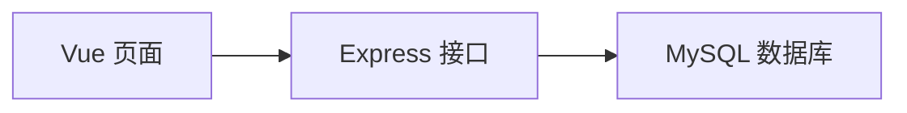

# 图书管理系统的设计与实现

## 摘要

本系统面向图书信息维护，提供列表查询和图书信息录入功能。论文依据源码整理，功能测试结果待验证。

关键词：图书管理；Web 应用

## Abstract

This draft describes the implemented book management application. Tests remain unverified.

Keywords: library; web application

## 第一章 绪论

### 1.1 项目背景

图书信息采用统一页面进行维护，列表展示与录入流程通过接口连接。

## 第四章 系统设计

图4.1 系统架构图

| 字段 | 类型 | 说明 |
| --- | --- | --- |
| id | int | 图书编号 |
| title | varchar | 图书名称 |

## 第六章 系统测试

| 用例 | 预期结果 | 实际结果 | 状态 |
| --- | --- | --- | --- |
| 查询图书列表 | 返回列表 | 待验证 | 待验证 |
